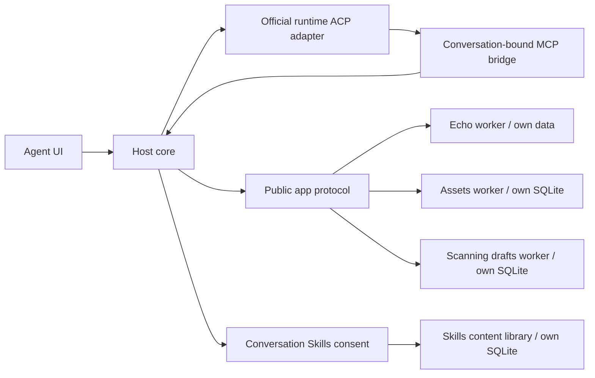

# Agent-first 阶段实现与回归记录

此分支提供可以独立构建、启动和安装应用的迁移 Host；旧桌面完整保留。它尚未替代旧 Assets 全部能力和扫描执行引擎，不能作为“完整业务迁移已完成”的收据。验收表见 [AGENT_FIRST_ACCEPTANCE_2026-10-16.md](AGENT_FIRST_ACCEPTANCE_2026-10-16.md)。

## 来源、环境与工作范围

仓库 `swyiic/Oviraptor`，独立分支 `feature/agent-first-app-platform-20261016`，起点为实际远端 main `19756cecd5d457c3128af3e7806c5c2990443d69`。该起点已经包含此前云端 WIP、本地源码语义整合及资产准确性修复；没有重新用 main 的配置默认值替换 WIP。旧移交包的 SHA256、恢复根与原真实基准，以及过滤测试的处理，见 [LOCAL_INCREMENTAL_INTEGRATION_2026-10-15.md](LOCAL_INCREMENTAL_INTEGRATION_2026-10-15.md)。本阶段没有接触用户 Mac、覆盖本地源码或合并 main。

实际环境为 Linux、Node 24.19.0/npm 11.9.0、私有 Rust 1.99/GTK/WebKit 工具链。未发现适用的 AGENTS.md。新 Node 包不新增第三方运行时依赖，使用 Node 内置 SQLite。Rust 检查保留原七个 ignored，不把它们计为通过；云端检查不代替 macOS/Windows 打包或真实 Tauri GUI。

先提交设计和验收清单 `875c06d`，再分批实现。第一批冻结点 `1613f1a` 有实际 132 项 Node 和 6 项 Chromium 回归，但它早于后续撤销/升级修复，只作为历史检查点保留。

| 阶段 | 可审查提交 | 主要文件与实际检查 |
| --- | --- | --- |
| 资源读取契约 | `8f93758` | `src/features/skills/api.ts` 与实际 invoke 回归；后续边界/读取组合 32/32 |
| 公开 SDK 与 Echo | `ec04b0b`、`1bb3df8` | `packages/app-sdk`、`examples/echo-app`；22/22，包括真实 stdio worker 和 Unicode 字节预算 |
| 官方 Agent 适配 | `acb136b`、`493f4d8` | `packages/runtime-acp`；24/24，合成真实子进程及故障 transport，不冒充官方二进制 |
| 独立业务应用 | `2aead1b`、`bec6aae` | `apps/assets`、`apps/scanning`；四种安装组合 4/4，内存回归保留 OOM 红灯 |
| Host 与协议接入 | `d79bcaa`、`1613f1a`、`bd202cf`、`134d409` | `packages/agent-host`；权限、真实三进程 MCP 链、通知、取消和披露审阅分别留原始日志 |
| Skills 内容与会话同意 | `6bc4b78`、`fed3ded`、`40a17a7`、`e416cd6` | library 30、access 58、入口变更 6、实际 Host 链 5 项通过 |
| 升级与恢复 | `2d556e9`、`ea69ff7`、`3a332bc` | `apps.mjs`、`upgrades.mjs`、`store.mjs` 和恢复测试；候选副本隔离、失踪目录拒绝、卸载后精确恢复；最近 7+15=22 项通过 |
| 真实界面 | `4e161f0`、`4d9fd12`、`f84ee40`、`d4140d8` | `packages/agent-ui`；升级入口后 61 单元 + 16 Chromium 通过，发行目录另核对 |
| 原生边界 | `f1971fd`、`3d2eca1` | 只读桥与可信扫描服务环境；实际编译、116+3 定向通过；原路径 4 线程全套 3834 pass / 7 ignored，另保留 8 线程首跑的 1 项未解释失败 |
| 独立构建 | `d97420b`、`d29d55b` | 独立 Host/UI、目录应用打包与仓库外启动，不携带资产或扫描源码 |

## 业务归属与依赖

| 所有者 | 独立实现 / 数据 | 实际边界 |
| --- | --- | --- |
| Agent Host | `packages/agent-host`；项目、会话、消息、运行时会话、应用清单、版本指针、显式授权、计时 | 不导入 Assets/Scanning 代码，不初始化或查询其业务表。项目通过 Host 绑定上下文传入应用，模型不能覆盖 |
| Agent UI | `packages/agent-ui` | 默认 Chat，项目和历史、运行时设置、应用与 Skills 管理；页面关闭不等于后台停用 |
| 公开应用 SDK | `packages/app-sdk` | 版本/兼容性、有限 schema、文件清单校验、stdio 生命周期/工具协议；不包含业务实现、领域数据库或执行策略 |
| 现有 Agent 适配 | `packages/runtime-acp` | 官方命令的持久 ACP v1 子进程、会话/流/取消/许可/错误；没有重写通用 Agent 或套一层额外模型 |
| Skills | `packages/skills-library` | 独立内容库、来源/许可、指纹、导入和资源预算；按会话授权属于 Host `skills.mjs`，脚本不执行、不产生工具权限 |
| Assets 应用 | `apps/assets`，自己的 SQLite 和迁移 | 当前为有来源标识的库存导入、准确统计、分页搜索；尚无完整旧采集/归属/暴露面能力 |
| Scanning 应用 | `apps/scanning`，自己的 SQLite 和迁移 | 当前为持久草稿、取消和日志；没有把草稿描述成已运行扫描 |
| Echo 示例应用 | `examples/echo-app`，自己的版本化 JSON | 实际打包、安装、项目隔离、读写、升级/卸载生命周期；添加应用无需编辑 Host 静态注册表 |
| 原生扫描所有者 | `src-tauri/src/scanning/service_environment.rs` 及原执行链 | 提取可信数据/配置/资源根和事件出口，保留原权限、费用、birth receipt、guardian；暂未接入独立 Host |
| 旧数据兼容桥 | `legacy_app_bridge.rs` / `oviraptor-app-worker` | 显式只读快照投影；Host 不直接读旧业务库，当前应用也没有获得任意启动原生进程的权限 |

旧前端的 feature API、业务 types 和 Rust owner 拆分没有倒退为全局聚合。`common/shared` 没有加入 Assets、Scanning 或 Skills 具体逻辑；沙箱仍为内部能力。依赖检查和旧应用回归继续覆盖之前的模块边界。

## 已实现的协议、生命周期与授权

目录包包含 manifest v1、兼容版本、页面/工具/权限/生命周期和所有文件 SHA256。拒绝路径穿越、符号链接、缺失/额外文件、篡改和不兼容版本；执行 Host 管理的已复制包，启动前再校验。安装默认停用、无权限。worker 为真实进程，限制包/数据目录的 Node 文件访问，环境不复制凭据；这不构成恶意代码或网络的 OS 沙箱，也没有发布者签名。

允许能力是当前安装/启用/健康状态、项目授权和运行时披露的交集。授权同时绑定展示时的运行时身份及 revision，切换回旧运行时也不会恢复同意。调用前后复核项目、revision、进程和当前会话；撤销后的读结果不向模型返回。Host HTTP 绑定 loopback，API 使用每进程 token，拒绝错误 Host、foreign/opaque Origin；应用 iframe 无同源权限或 Host token。

升级在旧 worker 停止并实际退出后复制应用数据，候选仅迁移隔离副本。候选失败不切换当前指针；提交时事务切换包/数据并撤销授权。卸载保留最新数据代际；仅精确包身份可恢复，仍需新授权。busy 和未确认退出阻止卸载/升级。详见 [升级契约](AGENT_FIRST_APP_UPGRADES_2026-10-16.md)。旧原生执行 receipt 绑定可执行文件 SHA 与数据库规范路径，不能复制、重签或自动领养到新服务。

Skills 保留完整 36 技能/443 文件来源与内容，选择上限 128、工具列表每页 12；UI 资源默认 8192，与 Rust 上限一致。模型读取再受序列化输出预算约束，UTF8 页不切断字符。修改后改回文本、资源、来源、入口路径或所属包均不能复活旧同意；无关兄弟条目变更不误撤销当前选择。安装/选择 Skill 不安装工具，资源脚本只按文本读取。

ACP 的 `session/prompt` 完成元数据与增量 `session/update` 分开；支持持久进程复用、流、显式许可、取消、按能力 load 和错误隔离。取消请求与确认取消分开记录：race 中 `end_turn` 仍为已完成；超时/断连标记未知结果，不自动重放。MCP 真正经子进程调用 Host，而非只把工具名写进 prompt；工具变更通过标准通知更新已存在会话。

## 实际执行及发现的失败

原始证据在云端 `/workspace/validation/agent-first-20261016/`，不以旧版本通过数替代本次结果。清单绑定受测源码、命令、退出状态、日志和 SHA；中止或未运行的用例不记为通过。

可随分支拉取的原样文本/JSON 证据及 SHA 位于 [agent-first-20261016/evidence-index.json](agent-first-20261016/evidence-index.json)。受测独立代码为 clean `93e75a7af0cf908ddcf4961f9a4fac01486428e4`；完整 Node 的 2406 项输入前后无变化。原生源码另绑定 `3d2eca1`，其后尚未修改 Rust。

原生验证已封存，[最终原生索引](agent-first-20261016/native-service-boundary/native-final-acceptance-index.json) 与 [151 份原样证据清单](agent-first-20261016/native-service-boundary/native-final-curation-manifest.json) 一并入库，涵盖编译、定向、完整运行、重复诊断、中止和独立后验收据。可执行文件仅在云端保留，Git 记录其路径和 SHA；没有把 122 MB 二进制加入仓库。所有验证进程和观察器均已结束。

原委托中的六项 WIP 问题已按继承的桌面契约复核，见 [initial-wip-contract-review.json](agent-first-20261016/module-contract-review/initial-wip-contract-review.json)：23 个相关源码的当前指纹仍匹配；55 条交叉引用对应 36 个不同的 Rust 用例，均在本次 full02 原始日志中实际通过一次，不能计为 55 项独立测试。这是已有修复的验证，不是声称新 Host 已重做桌面全部功能。审阅同时保留精确 128/129 边界等覆盖限制，整个原生 full02 仍有另一项未解释的失败。

| 检查 | 已实际执行的结果 | 证据 |
| --- | --- | --- |
| 第二阶段独立 Node（早期快照） | 286/286、exit 0；后续新增回归另计 | `agent-first-03.log` |
| 新增审阅后全套首跑 | 306 总计，305 pass / 1 fail、exit 1；协议负例先触发过短测试预算，修复后 ACP 24/24 | `agent-first-04.log`、`acp-timeout-fixture/acp24-timeout-separation-result.json` |
| 最终独立 Node 全套 | clean `93e75a7`，320/320、exit 0，52.238 秒，源码/HEAD/Git 状态前后一致 | `final-node-result.json`、`agent-first-final-01.log` |
| Skills 内容库 / 会话授权 | 30/30 与 58/58；包含真实 bundled bytes/digest、预算、资源与撤销 | `skills-library/final-library-01.*`、`skills-access/final-access-01.*` |
| Host→ACP→MCP→Skills | 实际子进程/HTTP/SQLite，5/5；含撤销后 peer 蓄意返回 end_turn，Host 仍扣留结果 | `skills-host-integration/final-integration-01.*` |
| 升级 / 运行时设置 | 15+2=17/17 | `host/lifecycle-current.log` |
| 设置、CLI、计时与取消 | 15/15，包含真正 CLI 子进程 | `host/settings-metrics-cancellation-01.log` |
| 最终发行目录 UI | clean `93e75a7`，61 单元 + 16 实际 Chromium 全部通过；84 源码/41 发行文件前后无变化，旧 54/15 完整保留 | `ui/final-distribution-checkpoint-02/evidence-index.json` |
| 独立发行目录 | build exit 0；复制到仓库外启动，零应用保存消息、安装 36/443 内置资源；无 node_modules/Assets/Scanning 源码或模型请求 | `independent-build-final-01.log`、`independent-distribution-final-01.log` |
| 全部目录包构建 | Echo、Assets、Scanning 均 exit 0，实际包清单 SHA 各自记录 | `app-packages-final-01.log` |
| 独立依赖/数据审阅 | 33 个 ESM 模块、42 项输入、41 个发行文件逐项核对，无 Assets/Scanning 业务依赖；明确 Skills 元数据的窄 schema 耦合 | `module-contract-review/module-contract-map.json` |
| 旧前端全部 99 个 Node 文件 | 1666 总计，1654 pass / 12 skip / 0 fail，exit 0；旧输入未改，其他新包并行开发，不声称整仓冻结 | `legacy-parity/node-01-result.json` |
| 旧 Vue/TypeScript/Vite build | exit 0，18.017 秒 | `legacy-parity/build-01-result.json` |
| 原生 all-targets check | 实际 exit 0，61.783 秒 | `native-service-boundary/service-check-01-result.json` |
| 原生库编译 | 实际 exit 0，359.403 秒；列出 3841 项 | `native-service-boundary/service-lib-build-01-result.json` |
| 原生重点 / 源码守卫 | 116/116 + 3/3；七个旧 ignored 保持 | `native-service-boundary/native-service-validation-index.json` |
| 原生完整回归首轮 | 全部 3841、8 threads、无 filter：3833 pass / 1 fail / 原 7 ignored；实际 exit 101，harness 1657.70 秒；整体验收未通过 | `native-service-boundary/service-native-full-02-aggregate.json`、`service-native-full-02-command.log` |
| 同一原生二进制定向诊断 | 失败项 1/1 及邻近全部 15 项、8 threads、15/15 通过；没有源码、deadline 或断言变更，不能据此抹去首轮失败 | `native-service-boundary/service-paid-successor-exact-01-result.json`、`service-paid-neighborhood-01-result.json` |
| 原生邻近用例重复诊断 | 15 个不同用例重复 10 轮、每轮 8 threads，全部通过、各轮实际 exit 0；共 150 次执行，69.392 秒。使用同 SHA 的保留副本路径，不能视为仅改变并发的原路径对照 | `native-service-boundary/paid-neighborhood-repeat-10/repeat-result.json`，含逐轮原始日志及独立退出收据 |
| 原生 full03 提前停止 | 保留副本路径、4 threads；为消除执行路径混杂，主动停止自有测试进程。1413 项已完成＝1406 pass + 7 ignored、0 fail；无 footer，实际 exit 143，外层 111.153 秒，不计全套通过 | `native-service-boundary/service-native-full-03-threads4-aggregate.json`、`service-native-full-03-threads4-abort-request.json`、`service-native-full-03-threads4-independent-outer-receipt.json` |
| 原生 full04 原路径重跑 | 与 full02 相同二进制、原路径和输入，只将 threads 从 8 改为 4；3841 项各一次，3834 pass / 0 fail / 原 7 ignored / 0 filtered，实际 exit 0；harness 2168.28 秒，独立外层 2171.734 秒 | `native-service-boundary/service-native-full-04-threads4-original-aggregate.json`、`service-native-full-04-threads4-original-command.log`、`service-native-full-04-threads4-original-independent-outer-receipt.json` |

本阶段发现并真实修复：流式文本被历史刷新覆盖（旧浏览器 5/6 失败）、Echo Unicode 结果超过预算、取消被误称成功、技能入口变化未进入快速撤销代际、资产搜索全量驻留内存、已持久化数据目录丢失后静默重建。保留原失败日志；资产搜索同一 30000 行/32 MiB fixture 原实现真实 OOM，修复后通过，统计/游标/项目/数据 SHA 断言不变。协议版本/认证负例的 80 ms 测试预算被拆开：正常协议响应使用既有 1000 ms，故意挂起仍为原 80 ms，生产 deadline 与错误断言不变。原生 full 启动脚本第一次因仓外证据 fresh-prefix 冲突在启动二进制前失败，执行零用例，保留为验证器失败；第二次用新前缀正常执行，没有改源码或跳过测试。

最终 UI 发行检查首个验证器也在预检拒绝、执行零用例：其映射未包含 builder 已明确复制的 SDK `bin/pack-app.mjs`。仅同步仓外验证器的这一映射，保留旧结果与全部测试/闭包守卫，再实际得到 41 文件闭包、61 单元和 16 浏览器通过；没有因此修改受测产品源码。见 `ui/final-distribution-checkpoint-01/result.json` 与 `ui/final-distribution-wrapper-v2-review.json`。

## 原生失败与重跑

原生 full02 的唯一失败为 `lease_paid_successor_before_sdk_retains_original_fees_without_publication_or_resend`，真实 panic 位于 `agent_tests_lease_paid.rs:36:63`：Mapper 首次 transport 返回 BeforeTransport Cancelled，尚未执行后面的人工 expiry、successor mutation 或费用断言。相同夹具及授权链与历史已通过源码逐字相同；共同 tag 串扰假设已被排除（每次 UUID 私有库/scan，取消 token 不使用全局 scan map）。取消 predicate 会把监督、DB/lease/能力读取失败或 deadline 等原因折叠成该返回，因此原因仍未知，不能断言是用户操作、时钟或本批改动。保留完整 101 和原二进制 SHA `113a0e3e57132be4c62f6b2c247343a566dceacef071f8ca510e79f2b611632a`，定向绿色不等于问题解决。

十轮诊断与 full03 使用内容相同、路径不同的保留副本；路径可能影响 `current_exe` 或资源身份，因此 full03 提前停止并以原路径重新开始 full04。full04 保留原 600 秒时效用例、费用、授权及全部断言，于 05:12:36 UTC 自然结束。1774 项受保护原生输入、额外完整 native 1843 项和 audit 2272 项的路径/内容均未变化，四个历史二进制也保持原 SHA。运行期间仅文档和证据有变化，前后清单单列这些差异，不声称整仓 HEAD 未改变。云端连接通知后确认同一 PID 继续运行，连接中断本身不记为测试失败。本次 4 线程完整通过只证明该条件下的实际结果；不同轮次的时序和负载没有被固定，不能据此归因于并发，也不能认定原 8 线程问题已修复。其原因仍未知。

## Grok 与真实性边界

依据官方 [ACP/headless 文档](https://docs.x.ai/build/cli/headless-scripting)、[ACP v1 schema](https://agentclientprotocol.com/protocol/v1/schema) 和 [MCP tools 2025-06-18](https://modelcontextprotocol.io/specification/2025-06-18/server/tools) 实现。默认命令为 `grok --no-auto-update agent stdio`，通过官方 `cached_token` ACP 流程请求 CLI 使用自己的本地认证；适配器不读取/复制 OAuth 文件。

云端 PATH 没有 Grok。官方 installer URL 与官方 GCS stable pointer 实际 HTTP 403，尚未取得二进制或版本，不猜版本、不使用镜像。审阅了官方安装脚本文本但未执行；没有登录、付费调用、借用其他客户端身份、真实扫描目标或安全设置变更。真实协议握手、会话 load 支持及速度对比仍待官方二进制可用后的用户参与。

计时使用单调时钟，持久保存 cold start / first text / first tool / turn total / Host total / outcome；HTTP 导出按证据分组，未知、取消、拒绝保留在成功率分母。一次实际合成子进程记录为四个尝试、三个正常完成和一个故意崩溃（75% 是该故障 fixture 的事实，不能当作 Grok 成功率）。原始毫秒数据见 `runtime-fixture-metrics-01.json`。

## 未完成事项

完整 Assets 采集/归属/暴露面迁移、完整扫描执行服务、native worker 的公开 SDK 运输与打包、原有模型配置/Chat 全量功能等价、真实用户库迁移、官方已认证 Grok、Mac/Windows GUI 和发布签名仍未验收。当前扫描包只有草稿/日志，原生只读桥未接入 Host；本次提取的服务环境不意味着已经有独立扫描守护进程。

应用包目前仅适用显式选择的可信本地代码；缺少发布者签名与网络隔离。升级保留数据可能增加磁盘使用，尚无自动清理/回滚 UI 或通用执行域 canUpgrade 收据。所有旧未完/付费扫描继续由原桌面、原可执行文件和原数据库路径拥有，新应用不能自动恢复其执行权。后续迁移计划及不能放宽的 gate 见 [扫描服务迁移](AGENT_FIRST_SCANNING_MIGRATION_2026-10-16.md)。

下一阶段原生 bootstrap 的可审查候选保存在 [未应用补丁](agent-first-20261016/scanning-next-patch/rev2/README.md)。它仅通过语法、补丁适配及独立静态审阅，未应用到产品源码、未类型检查/链接/执行；其中 16 项仅是待运行测试规格。旧候选及三项阻塞的审查记录均保留，rev2 已静态闭合 DB 存活身份、完整响应预算和目标二次拆分的问题。该候选不计入本次已实现/已通过项目，也没有接通 SDK v2 或真实扫描执行。
