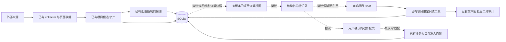

# 外部资产准确性与项目分析闭环设计

版本：评审稿 v1及阶段4补充，2026-10-15。**原稿已于 `6920ec9` 交付；用户随后明确授权实施阶段1–4，并要求修复聊天项目资产精确统计。阶段5–6仍未授权实施。**

阶段记录：`3ab0b40` 为后端准确性候选，`45d5434` 为UI候选；该源已实际通过 all-targets、default-feature opt1 测试二进制构建和完整 Node（1,638通过、12既有跳过），尚未执行完整 Rust 行为回归。下文第2节保留的是原文档暂停时事实，不能当作现在的完成或失败结论。新增第10.3节先明确聊天统计读取合同，再恢复该部分编码；其新源必须重新冻结验收。

本文以 `main 3102693abc135f4a2b986caca851bbc935378f0b` 为事实基线，tree 为 `51023994975002ef5330b8a59891441ac7a3754c`。文中“已有”指该基线的实际代码；“冻结 WIP”指独立工作树中的未提交初版；“拟议”均未实现或验收。不能把设计、测试函数的存在或历史通过数当作当前功能完成。

工作树：`/workspace/Oviraptor-asset-accuracy-20261015`；分支：`refactor/external-asset-accuracy-20261015`。暂停时 HEAD 为 `8cb45eb215516303c35902b0ee61e36a91161f91`，该提交仅记录第一版差距清单。本轮没有业务源码提交，没有合并 main，没有操作用户 Mac。

## 1. 目标、边界与结论

优先顺序是：**先把外部资产抓准、解释清楚，再对可信且有明确范围的材料做针对性分析。** 不先扩展自动扫描、漏洞验证或 AI 自主权限。

本轮设计需要解决：

1. 资产来自哪里、何时被来源观测、何时被应用取得、何时实际探测，彼此不能混淆。
2. 域名、IP、端口、协议与请求入口如何建立实体和关系，避免误合并、错误归属与字段拼接失真。
3. 查询成功、分页完成、范围覆盖、候选导入和主动验证分别到了哪一步；额度、超时、部分完成不能被绿色“100%”掩盖。
4. 原始依据可回溯、可重处理、已脱敏，并受明确的数量、字节和时间预算约束。
5. 现有会话项目上下文怎样读取这些证据，形成可复核的结构化分析，并在用户确认后复用原有业务编排。
6. SQLite、UI、权限与历史迁移共同保留真实状态，跨项目读取和执行不扩大。

明确不做：接内部资产台账、增加一套平行采集器、重写通用 Agent、把沙箱变成新业务模块、自动确认弱证据归属、自动发起漏洞扫描、偷偷更换模型或对真实资产/模型执行验证。本阶段只写文档。

当前已有两条可复用的链：资产收集/探测/持久化链，以及项目 Chat 的受控只读工具循环。**并非缺少 Agent 基础，也并非这些链已经形成完整业务闭环。** 缺口集中在资产观测与覆盖真实性、证据投影、结构化分析记录、审批后调用现有业务入口，以及结果回到同项目会话的连接。

## 2. 冻结状态：先保留事实，再恢复实施

### 2.1 已交付安装包保持不变

原版本 Apple Silicon 测试包已经成功构建并上传，不包含本轮 WIP：

- 源码：`3102693abc135f4a2b986caca851bbc935378f0b`；版本 `1.1.66`；target `aarch64-apple-darwin`。
- [构建记录](https://github.com/swyiic/Oviraptor/actions/runs/38716445644)，[下载制品](https://github.com/swyiic/Oviraptor/actions/runs/38716445644/artifacts/11963238588)，到期 `2026-10-29T10:12:07Z`。
- DMG：`Oviraptor_1.1.66_preview_3102693abc13_arm64.dmg`，25,763,132 字节。
- DMG SHA256：`de8375c171d262d59ddcb1abfc97a30cb5be24825525e78c1571dee2f848ff5d`。
- Actions 总耗时 17 分 26 秒；Rust release 编译 15 分 30 秒。237 项定向 Node 测试、2,613 个 tracked 输入前后哈希、12 个资源、严格签名校验、DMG 校验和只读挂载同树核验通过。
- ad-hoc 签名，无 Developer ID，未公证；未做用户安装与真实桌面运行验收。Linux 额外下载被环境网关 403 拒绝；上述镜像和签名检查在 macOS runner 实际完成。

不重建或修改该产物来冒充后续重构版本。后续包必须另有源码 SHA、制品名和独立回执。

### 2.2 暂停时在途源码清单

暂停后保留 **20 个 tracked 修改、9 个新增文件**，暂存区为空。业务源码未提交，以下都不能称为已交付修复：

| 范围 | 冻结文件 | 已落下的初版 | 尚未闭合 |
| --- | --- | --- | --- |
| 摘要/DB/接线，6 文件 | `assets/model.rs`、`commands/assets.rs`、`db.rs`、`db_schema.rs`、`jobs.rs`；新增 `jobs/collection_summary.rs`（均在 `src-tauri/src/` 下） | 可选 CollectionSummary DTO、runs 新列及重复可执行的 additive 迁移、list_runs 返回、执行路径摘要接线和未运行的测试 | 上游 collector 尚未产出完整合同；时间导入逻辑未改；`jobs.rs` 声明的 `mod asset_observation` 对应文件尚未创建 |
| 身份/归属，8 文件 | `jobs/asset_identity.rs`、`jobs/native_discovery.rs`、`jobs/native_discovery_tests.rs`、`commands/asset_ownership.rs`、`commands/ownership_authorization.rs`、`commands/ownership_directory.rs`、`commands/ownership_review.rs`；新增 `commands/asset_ownership_accuracy_tests.rs` | 非 Web 身份、网络标识校验、精确 host、endpoint 优先、来源冲突、来源预算等初版和未运行测试 | 三元组 merger 尚未接入 import；目录旧 normalized_value 兼容未实现；同时间择优与字段缺失处理仍不一致 |
| 原始收据，5 文件 | `jobs/native_fofa.rs`、`jobs/native_collection_resume.rs`、`jobs/native_collection_resume_transport.rs`、`jobs/native_collection_resume_tests.rs`；新增 `jobs/native_collection_resume_summary.rs` | 收据 v2、时间/版本/预算 helper、成功 payload 脱敏和未运行回归 | 生产循环尚未接新版 read/open/save 接口，短页/total/无效行判定仍是旧逻辑，typed summary 未调用 |
| 资产前端，10 文件 | `src/features/assets/types.ts`、`components/QueryPanel.vue`、`components/AssetWorkspace.vue`、`workspace/AssetsPluginWorkspace.vue`；新增 `collectionPresentation.ts`、`observationPresentation.ts`、`components/CollectionRunSummary.vue`、`components/AssetObservation.vue`；新增 `tools/asset_accuracy_ui_harness.cjs`、`tools/test_asset_accuracy_ui.cjs` | 覆盖与执行分开、可选摘要、时间标签、实际配置说明、真实 SFC 合成 IPC 测试 | 后端历史标记尚无 producer；仪表盘及部分筛选旧措辞未覆盖；最后四文件修改后未重测 |

**当前 WIP 不能作为可编译版本验收。** 已静态确认缺失模块文件、collector 接口错位和 import 三元组未接线；本阶段不为修复这些断点而继续改源码。

暂停快照保存在 `/workspace/validation/asset-accuracy-20261015/paused-wip/`：`manifest.json`、`frozen-inputs.json`、`source-wip.patch`、`untracked-sources.tar.gz`。清单记录 2,623 个当时输入；它用于防止暂停期间丢失或无意改变工作，不是测试通过证明。正文不包含凭据或真实用户资产样本。

### 2.3 已执行检查与适用范围

| 检查 | 真实结果 | 能证明什么／不能证明什么 |
| --- | --- | --- |
| 新 Rust 编译、all-targets、行为回归 | **均未运行** | 仅准备了独立 dependency cache 与验证入口，不能宣称 Rust 通过 |
| Rust 格式检查 | 首次缺私有工具链环境 exit 1；配置环境后 4 个独占文件 rustfmt exit 0 | 仅解析/格式，不是业务或集成编译 |
| 既有前端定向 | 67/67，exit 0，4.702s | 当时 WIP 的组件范围；没有完整输入哈希，早于最后修改 |
| 新真实 SFC 定向 | 27/27，exit 0，1.026s，41 个输入前后 SHA 一致 | 合成本地 IPC；其后四个 presentation/component 文件已变，不能用于当前全部 WIP 验收 |
| 前端构建 | 旧日志显示 vue-tsc 完成、Vite built in 6.54s；当次没有完整退出码/总时长回执 | 早于最后修改，不作为当前源码构建通过 |
| main/旧整合的测试 | 保留原报告和原二进制 | 历史通过不转记到本轮 WIP |

证据位于 `/workspace/validation/asset-accuracy-20261015/frontend-tests/focused-02-*`、`/workspace/validation/asset-accuracy-20261015-frontend-existing.log`、`/workspace/validation/asset-accuracy-20261015-frontend-build-01.log`。旧 full03 二进制与日志未改；独立 `/workspace/asset-accuracy-target` 仅复制外部依赖缓存，没有启动新 Cargo。

## 3. 现有业务职责与真实数据流

### 3.1 各模块做什么

| 业务 | 现有入口/调用链 | 输出 | 本设计如何复用 |
| --- | --- | --- | --- |
| 外部检索/抓取 | `assetApi.startJob → jobs::start_job → execute_job → native_workers::collect_fofa` | 查询计划、页面检查点、query_log、候选 CSV | 在原 collector 修完整性与观测合同，不增加平行爬虫 |
| 候选整理/分层 | `merge_url_inventory → refine_candidates` | 同端点来源合并、P1/P2/P3 | 是检索排序/候选分类，不是归属确认，也不是当前存活证明 |
| 主动服务探测 | `native_probe::probe_assets → optimize_src_assets → import_csv` | 时间、状态、响应完整性、指纹、登录/注册等观测 | 保留原探测边界；按配置执行，不把公司名命中当授权证明 |
| 资产持久化/人工处理 | `jobs::import_csv_with_progress`、`commands::assets`、page isolation | assets、project_assets、asset_events、规则效果 | 保留资产 ID、人工决定、回收/恢复、展示折叠；改变事实投影而非重建总账 |
| 归属及资格 | ownership profile/assessment/review/authorization | 候选/归属结论、反证、人工授权及版本 | 弱线索不自动 confirmed，不把“人工保留”当归属或执行资格 |
| 漏洞/调查/Native 任务 | `scan_lifecycle` 草稿、`scan_control` 确认/准入、现有 runtime | scan/run、预算/租约/收据、调查图和结果 | 只在明确批准的后续动作中调用原入口，不由 Chat 直接创建底层执行记录 |
| 独立 Chat | `conversations::reply → agent::run → controlled_executor` | 文本回复、只读工具活动、会话 links | 保留已有受控循环，增加窄证据接口和业务分析对象，不重写通用 Agent |

`assets/fofa.rs` 的账号/Key 预检不是采集器；`native_pipeline/analyzer.rs` 是容器/规则/SARIF 等分析器执行与结果归档，不能仅因名称 analyzer 就把它当聊天式资产 AI 归属分析。

冻结基线证据：`jobs.rs::start_job` 约 1402 行、`execute_job` 1017 行；`native_fofa.rs::collect_fofa` 538 行；`jobs.rs` 1151 行先导入候选、1166 行根据 runProbe 决定探测。默认探测目前仍开启，但用户可以关闭；本轮不擅自改变基线默认值。

### 3.2 已有与拟议连接



实线表示现有能力；虚线是尚待实施的业务连接。只读工具循环已经存在；从结构化分析到动作审批/调度仍未接通。

## 4. 代码核实的准确性缺口

| 优先级 | 实际触发条件 | 基线代码证据 | 后果与处理要求 |
| --- | --- | --- | --- |
| P1 | size=1000、pageSize=500、第一页仅100行；或 size 缺失/为字符串 | `jobs/native_fofa.rs:817–820,872–880,1027–1060` | 矛盾短页停止；未知总数回退当页数；可能误报 coverage_complete。只有覆盖被证明才能生成 missing |
| P1 | 来源 results 含空对象/空数组，或字段错位/无实际网络标识 | `native_collection_resume.rs::valid_page:221`、`native_fofa.rs::flatten_fofa:299`、`asset_identity.rs::canonical_identity:57` | 空记录可成为 raw identity、计入数量。明确拒收计数和覆盖影响，不能用非空 fallback key 代替有效网络实体 |
| P1 | 恢复旧 probe journal 或重导同一页面 | `native_probe.rs:177,918`；`jobs.rs:620–621,646` | 原 probe_checked_at 保留，但 last_seen/last_alive 被写 now，制造新鲜度。重放不得刷新观测时间 |
| P1 | 无 scheme、同主机/端口、不同明确非 HTTP 协议 | `jobs/asset_identity.rs::endpoint_url:20`；`native_discovery.rs::merge_discovery_rows:143` | 按端口猜 Web scheme 造成身份合并；探测 URL 猜测和实体等价必须分开 |
| P1 | 后来的候选改 IP/protocol，保留旧 probe outcome/title/proof | `jobs.rs::import_csv_with_progress:608–646` | 一行混合多个观测时点；旧探测不证明新入口。保留历史观测并明确标记，不能暗示当前已验证 |
| P1 | 精确规则 www.example 与 example 互相命中；domain 与实际 link 冲突 | `commands/asset_ownership.rs::normalize_ownership_domain:12`、`host_equals_rule:36`、评估约259行 | 精确主机归属不精确，来源字段可变成强证据。主机/父域规范化分开，实际请求 endpoint 优先，冲突保留反证 |
| P1 | 多查询/多时间命中同一实体，采用首个非空字段 | `native_fofa.rs:844`、`native_discovery.rs::merge_discovery_evidence:136` | 可能拼出从未出现过的“混合观测”。应选择整份观察的确定性 winner，而不是逐字段拼接 |
| P1 | 达页上限或不完整查询后任务执行成功 | `jobs.rs:1297–1307`、`jobs/job_lifecycle.rs:46`、`AssetsPluginWorkspace.vue` | completed/100% 被理解为资产已取全。执行终态与 coverage 单独显示 |
| P1 | 额度/超时后 collector 保存了候选并返回 Err | `native_fofa.rs:1028–1053`、`jobs.rs:1098–1151` | 磁盘候选尚未导入，UI不能把“保留候选”当“已入库/已探测”；typed 摘要必须独立传递 |
| P2 | 旧缓存跨天、缺 receivedAt、重复 native-cache、没有全局保留预算 | `native_collection_resume.rs::SavedPage:98`；`native_fofa.rs:733` | 无法证明分页同一时间窗；磁盘可无界增长。收据有版本、时间、完整性和明确回收/限额状态 |

现有 `jobs.rs::mark_missing:731` 只有 complete 与 coverage_complete 均 true 才写 missing，文案也明确“不等同下线”。这个门禁应保留；问题是上游可能错误给出 true，不能据此声称当前所有不完整采集已安全处理。

检索范围与主动访问范围也有已知差距：FOFA 公司名会生成 title/body/cert 候选，P3 也可进入原 probe；域名过滤目前偏向 host，而探测偏向 link；非私网字面地址检查不能代替项目授权，重定向逐跳范围仍需专项检查（`native_fofa.rs:166,822`、`native_probe.rs:525,820,897`）。本轮不扩展主动访问；后续如改准入，应单列兼容与授权审查，不能假称当前已按项目允许集封闭。

## 5. 统一数据语义：五种结论分开

### 5.1 不用一个“确认”表示所有含义

| 维度 | 表示什么 | 不能推出什么 |
| --- | --- | --- |
| discovery/candidate | 外部来源返回并通过基本身份校验的线索 | 不表示属于该公司、现在可访问或已获准操作 |
| observation/probe | 指定入口在明确时间的一次来源报告或主动测量 | 不保证现在仍可达，不自动推导其他同 IP 主机 |
| project decision | 用户人工保留、待定、拒绝、回收等项目操作 | 不自动等于组织归属确认 |
| ownership | unreviewed/attributed/related/confirmed/third_party/excluded 等归属事实 | 自动 attributed 或高分不等于人工 confirmed |
| authorization/eligibility | 本项目明确授予的执行资格及范围 | 不由上述任意弱线索、模型建议或会话上下文产生 |

沿用现有字段和门禁，优先统一 UI 文案及数据来源，避免第一步就迁成另一套状态机。共享 IP、ASN/CDN、同图标、相同内容、同证书、标题/品牌命中只能作为线索；多条相关弱信号不能简单累加成“已确认”。

### 5.2 实体与关系

拟议的身份合同：

- 请求入口 identity 保留 scheme、非默认端口、完整主机、路径大小写、尾斜杠和 query；只消除确定等价项，如规范主机大小写、默认端口、fragment。
- 明确非 Web 服务额外保留 protocol/transport；`ssh` 与 `redis` 不能因为同 host:port 而合并。未知协议保留 unknown，不猜成确定 HTTPS 服务。
- 域名入口与解析 IP 是关系，不是同一个实体。多个域名共享 IP/CDN 不合并；域名多 IP 随时间保留观察。
- `endpoint_url` 可继续为现有探测提出有限访问候选；`canonical_identity` 才定义存储等价。两者不共用“猜测结果就是事实”的语义。
- 有效 host/IP/port 校验与 identity 分开；无 scheme 的合法旧 host 可以兼容，空网络标识、非法端口、带凭据 URL 不应仅凭 raw asset_key 成为有效候选。

历史兼容：优先从旧行原字段重新计算身份，同协议同入口继续复用 asset_id；若 company+raw_key 已存在但对应不同 canonical，必须分配稳定不冲突的新 key，不能 ON CONFLICT 覆盖原服务。不能从已经误合并且丢失的历史字段凭空恢复所有实体；该部分应标记待核对，不批量拆分、删除或重置人工状态。

展示响应折叠继续只影响展示；完整成员、各入口、原 URL 导出与现有锚点范围均保留，不用内容相同代替实体相同。

## 6. 来源观测、时间与投影

每次观察最少包含：project_id、run_id、provider、query/page/request 摘要、source record 标识、实际 fields、payload hash、received_at、provider_observed_at 原值、parser/identity/rule 版本、有效性/拒收原因、对应实体和冲突。

时间分四类：

1. **provider_observed_at**：来源声称的观测时间，保留原始文本/时区属性；没有时区时不能假定为本地或 UTC，与其他时钟做精确先后证明。
2. **collection_received_at**：应用首次完整取得该页时记录的带时区时间。检查点重放保留原值，不能取文件 mtime 或恢复时刻冒充。
3. **probe_checked_at**：真实测量时记录的带时区时间。缓存复用不产生新测量时间。
4. **imported_at / job 时间**：本地处理行为时间，可用于操作审计，不能表示资产存活或来源新鲜度。

拟议投影规则：

- source 与 probe 分别比较同类、可证明的时间；旧/未知时间的 probe 不覆盖已知较新的 probe；旧 source 不覆盖较新 source 技术字段。
- 重放同一 receipt 不刷新 last_seen/project_last_seen/last_alive，但允许同一观察的派生分层、清洗规则结果按版本重新计算。
- last_alive 只来自已验证的正探测时间；未知历史记录继续 unknown，不补 now。
- 新候选改变 IP/入口时，旧 probe 仍可保留为历史，但须保留被测 endpoint/IP、原时间和历史原因。UI 不能把旧 outcome 配新 IP 当当前验证。
- 同时间冲突使用统一、确定性规则选择**整份观察**，技术字段和 receipt 必须指向同一 winner；新观察缺字段标 unknown，不从旧观察补成未实际出现的混合事实。
- `extra_json` 可先承载兼容字段，但不能把项目专属归属/授权放到全局 assets 共享列中。完整观察账与当前投影的拆分在后续迁移中显式实现。

当前 import 尚未实现这些规则；`probe_history_reason/probe_observed_ip/probe_observed_endpoint` 也只是拟议字段，不能把已有 UI 读取代码当作后端已产出。

## 7. 查询完整性、错误与任务摘要

### 7.1 独立的执行状态和覆盖状态

保留原任务 queued/running/completed/failed/cancelled/interrupted 等生命周期；不要为显示 partial 而伪造成功终态。额外表达：coverage `unknown/partial/complete`，查询和字段覆盖可分别细化。

证明 coverage_complete 至少需要：

- 查询计划明确；每条计划查询均有可验证的结束依据。
- total 为有效、语义明确且没有相互矛盾的值；未知总数不以当前页长度替代。
- 已取记录覆盖声明总量；遇到 total 仍大于 fetched 的短页/空页为不完整。
- 跨页 total 变化、重复页、非法记录、字段权限回退和分页/额度/磁盘限制都有显式原因，不静默取全。
- scope 过滤与无效记录分开计数；本来不在范围的结果不混进有效资产，也不能伪装为来源从未返回。
- legacy 时间未知或混合快照的影响单独声明。时间新鲜度、字段完整性和结果覆盖不是同一个布尔值。

若 provider 不能提供稳定快照，最多声称“按本次查询和分页规则取得”，不能声称互联网全量或同一时刻的完整快照。字符串 total 是否接受必须按已核实 provider 合同严格解析；无法证明时 unknown。

### 7.2 候选数、导入数和探测数

拟议 `JobRun.collectionSummary` 为可选，旧记录 null；包括 schemaVersion、executionComplete、coverageComplete、queries/completedQueries/failedQueries/truncatedQueries/partialQueries、invalidRecords、candidates、importedCandidates、probedAssets、reusedPages、errorCategories、reasons。

- null 表示未知或未执行，0 表示实际执行后为零，二者不互换。
- candidates 表示保留的有效候选；不等于新增资产数，也不等于已入库。
- importedCandidates 来自真实导入结果/有效行计数，不能用 inserted+updated 冒充全部已处理行。
- probedAssets 来自实际探测收据，不用候选数或 progress 推定；恢复复用另记 reused，不能当新请求次数。
- 错误采用稳定类别，如鉴权、额度/限流、超时、连接、读取、字段限制、取消和存储预算。UI 不解析错误字符串推断覆盖。
- 失败时保留已有原始材料和 typed state；磁盘已保留但尚未导入的候选明确显示为已保留/待导入，不继续后续扫描来遮盖失败。

摘要从原子 collector state 映射并持久化到 SQLite。UI 重连从 DB 读取，不只依靠前端事件或临时日志。只有覆盖证据真实通过，才允许原 `mark_missing` 写“本次未再次发现”；始终不等价于下线。

## 8. 原始依据、脱敏、去重与有界保留

### 8.1 收据与内容分开

拟议在现有 checkpoint 上演进，而非另造采集器：

- request receipt 保存 project/run、查询/字段/page、绑定摘要、接收时间、来源时间、内容 hash、格式/规则版本、redaction 状态与失败类别。
- payload 按脱敏后的内容 hash 存储；同项目/当前 run 可复用同一 blob，多条 request receipt 关联它，消除新的 native-cache 全量副本。
- 物理去重不授予读取权。第一步不做跨项目可枚举的共享 blob 接口；拥有 hash 不等于有权读取内容。
- 哈希语义必须标明是原始 bytes 还是脱敏后规范 JSON。二者不能混用；脱敏原文不再声称原始字节复现。
- 保存必要 fields、规则版本和拒收依据，支持离线重新解析/规范化；重处理产生新派生版本，不改写旧收据冒充原观察。

### 8.2 凭据与不可信数据

账号 Key、代理凭据、Authorization、Cookie 等不进入 request URL/回执/日志；配置密钥可只保留不可逆绑定摘要。成功 payload 也可能回显秘密，不能只脱敏错误。短凭据不能因长度小于阈值而遗漏嵌入替换；若安全脱敏破坏必要结构，降为 metadata_only/不可重处理并明确原因，不能同时宣称原文完整。

不索要或输出疑似秘密，不把原始页、数据库或真实资产上传模型做测试。HTML、标题、证书主题、项目说明、笔记、Skill 内容、文件及模型输出都作为不可信数据，不执行其中指令或 URL。原文浏览默认转义，不自动加载外部资源。

### 8.3 预算应覆盖真实磁盘，而非只写常数

以下是**拟议默认值，待文档范围评审后实施和验证**：

| 对象 | 拟议预算/到期 | 到限行为 |
| --- | --- | --- |
| 活跃 run 原始页面 | 512MiB、4096页；7天原文窗口 | 拒绝新增超额原文、保存原因和部分状态；不驱逐正在写入的数据来假装可恢复 |
| 全局/项目原始内容 | 初始全局2GiB，项目公平份额；可配置 | 只在受控目录清理已完成且未固定引用的到期 blob；没有可回收空间则明确 resource_limited |
| query/receipt 元数据 | 独立字节/条数上限；原文过期后保留摘要和 tombstone | 记录已清理数量、hash、原因与策略版本，显示证据已到期而不是“从未采集” |
| 运行展示日志 | 拟议5000条/run、100000条全局、30天；单条限字节 | 合并重复噪声，保留关键错误/收尾及裁剪计数；不把日志保留当原始依据留存 |
| 分析证据快照 | 单次有界摘录、明确保存期/引用固定期限及总预算 | 到期后不可继续批准依赖已失效材料的动作；刷新证据或显示不可复核 |

这些默认值不是用户机器容量建议，也不是已测性能承诺。预算必须计入 pages、legacy-pages、缓存、历史元数据、派生 CSV、临时文件与日志的各自份额，防止把512MiB页面预算误说成整个 run 或全应用预算。

当前 WIP 的7天仅在打开当前 run 时惰性检查；512MiB/4096页仅统计该 run 的收据文件；所有历史 run、CSV、元数据和 logs 尚无全局上限。**此初版不能称为全局有界保留已实现。**

拟议清理器只处理应用拥有并带版本标识的存储目录，拒绝符号链接逃逸；先写 tombstone/引用变更，再原子删除无引用 blob。活跃 writer、审批所需材料、人工归属/授权审计与旧移交包不被静默清理。崩溃恢复、并发、预算耗尽、未知旧格式均需回归；不无限重试或无限追加日志。

## 9. 归属、冲突与历史人工决定

现有自动评估跳过 manual，并写 `authorization_status='unknown', exposure_eligible=0`；授权动作要求人工 confirmed 并继续现有 CAS/版本校验。参考 `commands/asset_ownership.rs::assess_asset_ownership_for_connection`、`ownership_authorization.rs`。保留这些合同，不以新评分绕开。

拟议改动：

- 精确 host 使用保留 www 的 host 规范化；根域/子域规则另有显式语义。
- 实际 link/host 是 endpoint 身份的依据；来源 domain、公司标签、IP 等是独立证据，冲突时降级并保留反证。
- 同 IP/CDN/证书/图标/内容只形成技术关联；不得传播所有权或执行资格。
- 自动归属算法版本升级使派生快照/预览失效，不能自动撤销或改写既有人工作出的 confirmed/授权。

历史目录存在原 value 保留 www、normalized_value 已去 www 的情况；直接换规范化写入可能造成重复或 UNIQUE 碰撞。后续需用原 value 重新构建精确 read 索引、同实体幂等复用和跨实体冲突检查。`host-v2:<exact-host>` 作为新内部唯一键只是候选兼容方案，**尚未落地或确认最终采用**。

旧 learned rule 若 pattern 已丢失 www 且无原始依据，不能猜回原意。保留历史记录，将不能核实的 legacy 派生规则隔离出新的自动强支持，给人工复核路径；不将算法缓存失效等同于撤销人工作出的授权。

## 10. 当前会话项目上下文：已有实现与真实断点

### 10.1 已经实现的连接

| 环节 | 实际能力 | 基线证据 |
| --- | --- | --- |
| project_id 进入会话 | SendInput 携带 project/conversation/revision/operation；会话按项目联合查询，写入检查 active 与 revision | `conversations/model.rs:143`；`store.rs::project:51,conversation:106,writable:131` |
| UI 项目切换 | App 保存选择；Chat 接收 projectId；epoch 清空旧会话并丢弃迟到返回 | `App.vue:218,473,505`；`useConversationWorkspace.ts:472–484` |
| 请求上下文 | 自动加入该项目 id/name/description/status，作为不可信字面上下文 | `tools.rs::project_context:19`；`reply.rs::request:105–163` |
| 授权读取 | Agent 默认开、资产/扫描默认禁读；扩权需显式授予，endpoint/model/local 与 Skill 内容绑定同意 | `access.rs:131,247`；`access/consent.rs:8,32,51,75` |
| 只读工具循环 | project_get_context、assets_search/read、scans_search/read_summary、获准 Skills/目录；已有controlled_executor适配 | `tools.rs:36–58,133–159`；`agent.rs::run:328–388` |
| 持久化 | 先事务保存 user/reply operation 再发模型，完成后保存文本、usage/context hash；记录脱敏工具活动 | `reply.rs:188–277,342–467`；`schema.sql:3–83` |
| UI 回传 | 每1500ms读取状态，展示消息与已保存的工具活动；关联资产可打开同项目资产工作区 | `useConversationWorkspace.ts:71,388`；`ConversationWorkspace.vue:171`；`useConversationPlugins.ts:113` |

现有模型工具调用上限为4轮、总计8次、每轮4次；参数和输出各有边界，最终工具 JSON envelope 上限32768 bytes。工具 schema 不接受任意 project_id、SQL、shell 或目标 URL；后端在 dispatch 时重查权限，不能把前端禁用按钮当授权。

### 10.2 未接通的部分

1. `assets_search/read` 只读安全元数据，search 仅 host/title、最多20条；没有完整分页/总数，也没有 IP/link、probe outcome/time、来源收据、truncated、coverage 等准确性信息。不能据少量搜索结果宣称“整个项目已分析”。
2. `scans_read_summary` 只有摘要及最多20条 finding 标题，不含原始证据正文。需要有界、项目限定的证据投影，不能直接开放整个磁盘或表。
3. 工具活动只存脱敏参数和约240字符摘要；当轮结果正文只留在模型 history。后续请求加载最近64条 user/assistant 文本，不重建历史工具结果，因此当前审计不能还原分析时看到的完整事实快照。
4. 现有 assistant 结果是文本；没有独立资产分析 DTO、版本化 evidence refs、完整性声明和业务 JSON 验证器。普通文字拒绝也仍是普通回复，不是“分析已拒绝”业务终态。
5. 当前工具没有 collect/reprobe/scan/修改资产的写入口，SYSTEM 明确要求 live scan 使用已有可见配置和授权流程；已有通用 controlled_executor 不授予这些权限。
6. conversation_links 是经过项目校验的导航引用，不自动让模型读取内容。插件契约只支持 workspace 导航，不支持资产详情深链；按钮没有 targetId。`plugins/types.ts:51`、`ConversationPluginPanel.vue:38`、`store.rs::link:335,set_links:449` 是证据。
7. 全局工作台 IPC `get_investigation_graph(scan_id,target_url)` 和 `list_investigation_hypotheses(scan_id:Option,...)` 没有会话 project_id 校验，后者可全局列出（`commands/investigation_read.rs:133,187`）。**不能直接包装成 Chat tool**，必须服务端从会话范围验证 scan 归属后再读。

### 10.3 阶段4新增必修：精确项目资产统计及搜索边界

用户实测问“这个项目当前有多少资产”时，旧 Chat 只调用 `assets_search` 取得20条样本，因无总数字段而声称无法统计，并以ID跨度猜测数量；状态9+6+3仅覆盖18条而未解释另2条。该行为不合理，必须在本轮修复。这是已有同项目只读能力的窄证据读取，**不是结构化AI分析、审批或自主编排**。

实施合同：

1. Assets owner 提供精确库存统计与同口径搜索服务，Chat 只作有界投影。复用真实 `asset_filter`、查询验证及单次 SQLite 读事务；不在 Chat 另建近似资产 SQL，不从样本或模型文本统计。计数以项目内不同 `asset_id` 成员为单位，关联及多条 Sentinel 记录不能放大计数。
2. 新增只读 `assets_get_stats`；项目只能取后端已验证的 `conversation.project_id`。沿用 `agent_enabled`、`read_assets`、provider disclosure、endpoint/access revision、每次 dispatch 和读后 live flight 复查。模型参数不接受 project ID、SQL 或任意路径。不得把资产数字塞入无资产授权的 `project_get_context` 或自动项目上下文。
3. 默认“项目有多少资产”指**全部未回收的原始成员**，包含尚未回收的 rejected/not_applicable；并独立给出包含回收的项目成员、未回收、回收及未知回收状态、筛选后成员。人工 rejected、not_applicable、ownership excluded、回收是不同轴，可能交叠，不能相加冒充互斥总量；页面隔离通常同时写 rejected 与回收，因此默认已排除该类。
4. 人工决定、探测结果等分组使用固定白名单及未知/未分类兜底；每个互斥维度须可核对到相同筛选分母。空值、未知枚举、历史无探测不补造成可达或已确认。独立轴/重叠指标明确标记，不能把9+6+3当作20条全部分布。返回 `asOf` 和本次读事务范围；它描述已保存库存，不证明现在在线，也不是跨请求持久快照。
5. 窄严格 filter DTO 复用资产列表的合法过滤及状态口径。**本轮有意把 Chat 的旧 host/title 字面搜索升级为资产列表同一八字段参数化 LIKE**（project name、company、host、link、ip、domain、title、asset_key，保留 `%`/`_` 通配规则）；工具说明、结果 `searchSemantics` 与回归须写明，不能伪称零语义变化。默认聊天统计不继承 UI 的 review/browser_review 队列或响应折叠。
6. `assets_search` 同时返回匹配 `total`、`returned`、`limit`、`hasMore`、明确 filters/scope/排序及 `asOf`，items 与 total 在同一读快照。 Chat 搜索和单条读取继续只返回未回收内容；新统计可提供回收聚合数量，不据此开放回收资产正文/备注或引用。模型要求 trash/all 行读取时应拒绝，不静默忽略该参数。结果继续最多20条；稳定ID游标若提供，须绑定项目、规范化完整筛选及真实排序，跨项目/筛选变更/非法token均拒绝。游标不能承诺跨调用旧快照仍存在。不得靠增大limit或让模型遍历分页回答总数。
7. 系统和工具说明要求数量问题优先使用精确统计；禁止用ID最大最小差推总数，样本不等于全量；权限不足或统计失败应明说，不能用0代替未知。所有返回 scalar 有长度界限、无raw body/secret，保留32,768字节完整JSON守卫和原轮次/调用预算。
8. UI `total` 开启折叠时是展示组数，`memberTotal` 是完整筛选原始URL数，`summary.all` 刻意忽略人工决定分组。明确这三个分母，不能直接与默认全库存数字比较。读取中、失败、旧筛选快照、真实零须区分；空探测结果显示未知。保留现有默认队列、查询键和配置默认值。

验收必须实际执行：临时SQLite服务与工具dispatch、fake模型中文数量问题/下一轮工具数据/最终保存；超过20条、稀疏ID、空项目、跨项目及游标、回收与人工/归属排除、重复关联、未知状态、完整同分母分布；搜索count/page同filter、与资产列表对应raw/member口径及SFC失败/零/旧快照。拒绝资产权限、provider consent、agent关闭、读取中撤权与endpoint变更仍须保留。只用临时数据和fake gateway，不访问真实provider、模型或目标。

该补充的代码与测试独立提交；`45d5434` 的通过仅用于旧阶段，新提交重新check/build及完整回归，不转记旧数字。

## 11. 拟议闭环：项目证据 → 结构化分析 → 受控动作

### 11.1 项目证据读取

由 Assets owner 提供窄的读取服务，而非让模型调用任意 SQLite/全局 IPC：

- 范围从后端已验证的 conversation.project_id 获取，模型不能覆盖；asset/scan/run/evidence ID 必须逐项检查该项目成员关系和删除状态。
- 先返回项目汇总、可用证据范围、source/probe 时间、候选/归属状态、coverage、已过滤/未知数量；再按稳定 cursor 读取有界样本和精确 evidence ref。
- 明示 total、returned、hasMore、filters、snapshotId 与截断。读20条最多说明该子集，不能给全量结论。
- 原始 payload 默认不进入模型；只提供已脱敏的必要事实与最小摘录，保持现有 consent 和工具输出字节上限。
- 外部内容被标为数据，引用带 source/run/hash/time；所有 refs 都由服务端发放并可重查，不能信任模型自造路径或 ID。

接口名称与 schema 在继续实施时单独定稿；此处不宣称新增工具已经注册。

### 11.2 结构化分析合同

首个分析目的限定为资产准确性/待核验分流，不做自动漏洞结论。建议记录：

```text
analysisId / projectId / schemaVersion / snapshotId / snapshotHash
purpose / modelRecipientFingerprint / model / promptVersion / ruleVersions
coverage: included、omitted、unknown、sourceWindow、limits
observations[]: assetRef、claim、supportRefs、counterRefs、time、uncertainty
recommendations[]: allowedKind、assetRefs、reasonRefs、requiresConfirmation
status / refusalOrFailureCode / usage / createdAt / completedAt
```

应用验证 schema、数量、字节、枚举、引用和项目归属；模型文字不是事实依据，confidence 不变成授权。缺失/伪造 evidence ref、越项目 ID、非法动作、过度结论、异常 JSON 应拒绝或保存为明确未接受结果，不直接入主资产事实。

保留可复核的脱敏输入快照和其 hash；当前工具调用审计不能替代它。已有运行内 `DecisionSummary` 的 observed/missing/suggestions/costNotes/risks 解析思想可复用，但不能把某个 scan/root 的类型见证或财务 scope 移给独立 Chat。

### 11.3 用户确认后的编排

第一版分析默认只读。后续如启用动作，模型只创建**建议**；应用展示操作类型、项目/资产范围、配置、费用/数据外发影响和有效时间，再由用户确认。

- 初始动作集合优先“打开原资产”“创建待核验清单”“按既有配置提出收集/复测草稿”，不增加通用 shell/任意网络/直接 SQL。
- 计划带 snapshot/version/actionHash/operationId。确认前后重查项目 active、成员、授权、recipient consent、配置、预算及证据有效性；变化则失效/重新预览，不静默扩大对象。
- 执行调用原 jobs/scan 的正式业务入口；不直接 INSERT run、绕过 scope/lease/fencing/预算/财务收据或从 Chat 继承扫描权限。
- operationId 幂等；重复点击、重启、超时未知不重复派发或收费。结果以正式持久收据为准，不以事件通知或模型“完成了”认定成功。
- proposal 计划状态与 owner 任务状态分开映射；保留 failed/cancelled/interrupted/partial 的真实含义。
- 最后把 run/analysis/evidence 的项目限定引用写回会话，UI 展示已保存的状态。删除会话不能默默删除业务分析或撤销执行历史。

现有可复用入口：`commands/scan_lifecycle.rs:12` 创建草稿，`scan_control.rs:20–28,125` 确认后冻结并在提交后派发；`native_pipeline/mod.rs:207,244` 保存并核验计划 hash；`scanning.rs:264–300` 显式 evidence/scope/financial/publication ports。此链不等于独立 Chat 已具备写工具。

## 12. SQLite 归属、兼容迁移与引用生命周期

### 12.1 现有表保留

继续使用 projects/targets/runs、assets/project_assets/asset_events、ownership 各表、conversations/messages/replies/links/tool_activity，以及已有 scan/runtime/investigation 表。归属规则不能移到 common/shared；Chat 不直接持有扫描 writer。

`investigation_*` 是侦察/假设业务图；`agent_runtime::evidence_graph` 是绑定 root/run/revision/provenance 的运行证据图，二者不能混称为全局“AI知识库”。`native_source_analysis` 仍有 source_review_not_completed 分支，不能把确定性归档等同人工/AI审查已完成。

### 12.2 准确性阶段的最小迁移

冻结 WIP 已草拟 `runs.collection_summary_json TEXT NOT NULL DEFAULT ''`，初始化用 ensure_column。设计要求：

- 新库/旧库/二次初始化一致；旧 runs 为空，即 unknown，不补“覆盖完整”，不改终态和 error。
- Collector 收据有独立 schema/规则版本，DTO有自己的 schemaVersion；映射明确，不靠任意 JSON 键碰巧相同。
- 观察兼容字段可先放 assets.extra，但不能继续无限 source JSON；来源列表有条数/字节预算和 sticky truncated 标记，下界计数不能冒充完整来源数。
- 在需要跨时点复核时增加 Assets owner 的观察账及 receipt 引用，而不是不断覆盖同一 JSON。建议主键/唯一约束使用 project/run/request/record/规则版本，确保同收据重复导入幂等。
- 新身份须核实旧 key 对应的真实 canonical；无法恢复的历史不猜测。保留 asset_id、manual decision、回收、page-rule effects、entry_opened_at 和事件。

### 12.3 后续分析表是拟议，不是已建

可采用 Assets owner 命名的 `asset_analysis_runs`、`asset_analysis_items`、`asset_analysis_evidence_refs`，以及仅在批准动作阶段引入的 action proposal/dispatch receipt；最终命名和字段待继续前评审。

- 每个对象都带 project_id；主键/唯一键、联合查询和外键共同约束范围，不靠前端过滤。
- run 保存 snapshot/model/recipient/usage/状态和 operation identity；item 保存验证后的结构化结论；ref 指向有权限的来源、hash和摘录。
- 会话与分析通过独立链接关联。会话删除只移除导航链接；业务分析按自己的保留/项目生命周期处理，不能因会话级 CASCADE 丢失审计。
- 项目删除/归档要更新已有 ProjectImpact/关联保护，未知关联不得绕过保护；新表、导出、清理器、迁移与恢复同时接线。
- schema版本、数据回填、部分失败/重入和 rollback 方案须同行提交。不得只加 CREATE TABLE 而漏掉旧库初始化路径或其他 feature 初始化执行器。

## 13. 跨项目、权限与外部内容边界

1. 后端 conversation+project 联合查验是根；模型参数中的 project_id 不可信，不允许覆盖。
2. assets 为全局表，安全读取必须经 project_assets；归属、备注和授权按项目关联，不将另一项目的结论继承给当前项目。
3. scan ID、run ID、evidence ref、分析 ID、分页 cursor、详情深链都绑定当前项目；错误不能泄露其他项目是否存在。
4. provider disclosure 绑定完整 endpoint/model/local、access revision 和 Skill 指纹；撤销后续工具与请求立即重新校验，缓存不能复活已撤销能力。
5. 普通显式 Send 与额外业务数据授权不同：**当前 provider_disclosure=false 仍可把会话文字和项目字面上下文发给已配置模型**；它阻止额外资产/扫描/Skill/目录数据扩权，不是一切模型请求的总开关。UI和设计必须如实表达。
6. 项目名称/description/笔记/页面/Skill/工具内容不能升级为系统指令；模型输出不能执行代码、外部请求或配置写入。
7. 证据快照只包含当前被授权子集；回复前后、分页、审批和派发重查版本。项目切换的 epoch 防迟到显示，不能替代后端隔离。
8. 只读分析授权、外发同意、目标主动访问、财务预算和任务执行授权是独立合同，不因“当前项目感知”或“Agent enabled”互相代替。

## 14. 模型不可用、降级与失败真实性

现有代码：模型不可用时用户文字仍可保存；前端通常设 requestReply=false，后端若收到回复请求则保存 unavailable，不生成模拟助手回答。超时/网络/工具不支持等失败不自动重发或换模型；存在 outcome_unknown，不能自动重复请求。

同时必须承认配置层现状：`model_configuration.rs::profile_with_id:149–175` 在 active ID 无匹配时选列表首项，云端 key/base 可来自既有环境变量（216–250行）；本地端点不借云凭据。不能写成“当前任何情况下都没有 fallback”。

拟议无模型降级只保留确定性能力：查本地资料、显示覆盖/时间/来源、人工筛选与归属规则、保存问题/草稿。明确显示“未进行 AI 分析”，不伪造分析结构、不把规则分层叫模型结论。模型拒绝、格式非法、额度、超时和网络失败各有状态，不用空结果代表无风险。

新增分析应显示实际解析出的 model/endpoint 类别和外发范围，冻结 recipient 指纹；不能暗中换 provider、换模型、重复收费或扩大权限。是否将现有“失效 active ID 取首项”改为显式失败，属于独立兼容选择，需在后续范围确认后实施；本轮不擅自改配置默认值。

## 15. UI：关键状态直观，明细按需展开

- 任务卡保留执行终态；旁边独立显示覆盖完整/不完整/未知。主行只显示查询、保留候选、已入库、已探测；失败/额度/截断和规则版本可展开。
- 资产主行标“候选/上次探测/时间未知/观测冲突”；来源报告、取得时间、探测时间、被测 IP/入口及来源证据放在详情，不用入库时间证明存活。
- 来源公司标签、人工有效性、组织归属和执行资格各有简短说明；状态不得合并成一个“确认”。
- 创建任务预览展示所选配置的实际 runRefine/runProbe，不无条件承诺“采集后自动探测”；仪表盘快捷入口也需一致。
- 从 Chat 可进入同项目资产工作区；详情定位是拟议新增 intent，须带项目和合法资产引用、迟到响应保护、缺失/回收提示与返回会话位置，不能把打开外部浏览器冒充应用内详情。
- 分析卡展示目的、范围/截断、时间窗、证据引用、模型/费用、未确定项和状态。动作需明确预览与确认；模型文字和执行结果分开。

## 16. 实施顺序、分批提交与验收

**阶段0：历史文档冻结。** 原稿已交付，用户现已明确要求继续阶段1–4；阶段4加入第10.3节精确统计与只读搜索修复，阶段5–6保持拟议。原冻结WIP与来源快照继续保留。

| 后续阶段 | 最小目标 | 实施边界 | 通过条件 |
| --- | --- | --- | --- |
| 1 | 恢复在途接线；覆盖真实性和输入拒收闭环 | 原collector/receipt/summary，无新增来源/扫描 | short/unknown/changed total、上限、错误、无效记录均正确；不会错误missing；SQLite/UI摘要一致 |
| 2 | 协议身份、旧 key 兼容、独立观测时间 | 原identity/import及最小迁移 | 不误合并；重放/倒序不刷新或覆盖事实；人工/回收/规则效果保留 |
| 3 | 精确归属、来源冲突及有界证据 | 原ownership和receipt存储，明确预算范围 | www/裸域精确；弱线索无授权；目录迁移幂等；存储/清理不无界、不逃目录 |
| 4 | UI真实性、精确项目库存统计与同项目窄读取 | Assets DTO/查询服务、Chat受权只读tools与现有UI | 精确total/unknown/回收与排除口径；搜索分页不猜数量；跨项目/撤权拒绝；UI分母及读取失败透明；真实SQLite/fake模型/SFC回归 |
| 5 | 结构化只读分析与持久快照 | 复用Chat受控循环和model gateway | schema/refs/范围验证，失败不假成功；证据与模型来源可复核；不派发动作 |
| 6 | 审批后复用既有编排、结果回会话 | 窄proposal适配现有owner，不新建executor | CAS、授权、预算、幂等、重启/未知结果/取消均真实；无需直写底层runtime表 |

每阶段只提交该阶段文件，并报告 commit、实际测试命令/退出/计数、输入范围、失败和剩余限制。代码冻结后再验收；不得用早期 WIP 或 main310 的通过覆盖后续变更。未经另行确认不合并 main。

## 17. 测试矩阵

| 层次 | 必须覆盖的行为 | 证据与验收要求 |
| --- | --- | --- |
| collector | 矛盾短/空页、缺失/字符串/负数/变化total、重复页、上限、字段回退、空对象/数组、字段错位、超时/额度/取消 | 本地FOFA合成服务/纯函数；coverage保守、拒收有计数、错误state可恢复；不访问真实provider |
| receipt/storage | 原接收时间、旧未知时间、hash破坏、脱敏成功响应/短密钥/代理回显、原子中断、并发锁、TTL/字节/页/全局预算、引用固定和GC | 临时目录；完整/部分/过期明确；不越目录、不读写用户数据，不把存在文件当有效证据 |
| identity/import | HTTP(S)/默认端口/IPv6/www/路径/query；同端口SSH与Redis；同raw key冲突；旧ID/人工/回收保留 | 真实SQLite导入；不以仅字符串快照测试替代生产路径 |
| observation | 同receipt重放、旧/未知/无TZ倒序、正/负probe、旧probe配新IP、同时间正反导入、缺失字段、分层/优化同receipt派生更新 | 时间不mint；winner与receipt一致；合法清洗不被盲skip；历史结果不显示当前验证 |
| ownership | exact www/apex、来源domain冲突、共享IP/CDN弱证据、旧目录normalized冲突、旧规则无法恢复、手工CAS/反证组 | 自动结果不confirmed/授权；人工原意不被算法升级改写 |
| migration | 新库/旧库、二次初始化、部分失败/重入、旧summary为空、项目删除impact、旧数据unknown | 临时库；无破坏回填、无全表重置、关联及审计保留 |
| Chat读取 | 两项目同名/同assetId引用、回收/删除/归档、跨项目cursor/ref/scan、epoch迟到、授权/endpoint/Skill变更 | 真实后端tool/IPC与SFC；拒绝越域，无外部模型数据 |
| 结构化分析 | 假引用、越项目、非法JSON/过大/未知schema、模型拒绝/无模型/额度/超时、不完整覆盖过度结论 | fake gateway；确定性拒绝，不换模型、不伪造结果、不自动执行 |
| 动作提案 | 用户确认、actionHash/CAS、配置/预算/授权变化、重复点击/重启、未知结果、取消与过期证据 | 现有owner的本地fixture；禁止绕gate直接调度或重复收费 |
| UI/集成 | malformed摘要不变绿、null≠0、历史/未知时间、实际profile、详情深链、无模型保存模式 | 冻结源码build、全量Node、真实Chromium合成IPC、必要Rust定向/完整suite，记录case和hash |
| 平台/发布 | Linux native通过与Mac实际包分开；签名/DMG/资源/安装运行分开 | 本轮旧DMG仅对应310；新版本需另跑macOS并留新回执，不从Linux推定Mac/Win/ARM通过 |

每次测试检查实际唯一 case 名称与数量，过滤零匹配不算通过；保留失败历史，不以修改断言或跳过用例冒充业务修复。合成 IPC、临时 SQLite、fake gateway 不代表真实用户数据库、provider 或桌面安装验收。

## 18. 继续前待确认的设计点与剩余风险

1. 本轮首先落实阶段1–4的资产准确性，阶段5–6按文档评审后的明确范围推进；不要让AI闭环扩大为新通用Agent或漏洞扫描重构。
2. 全局保留默认值、证据固定期限及清理交互需要评审；当前helper只有单run惰性TTL，尚未覆盖全局历史/日志。
3. provider稳定快照和total语义需以实际可核实合同确认；不能仅凭一页成功推断来源全量。
4. 历史误合并丢失的服务、已去www的旧规则、无时间记录不能无损恢复。设计提供待复核和unknown，不许编造回填。
5. 当前WIP存在缺模块和接口错位，旧通过不覆盖最后字节；恢复实现后第一步是最小接线并真实编译，而不是先宣称三项关键缺口已修好。
6. 现有主动probe的范围/重定向准入，以及模型配置层fallback保留独立审查；本轮不暗改默认值或将其描述为已闭合。
7. 结构化分析/证据快照/审批/执行桥和详情深链都是拟议能力；现有项目感知与只读工具循环则应直接复用，不再重复建设。

本文是后续工作的评审依据。原稿冻结事实保留；用户已要求继续阶段1–4及第10.3节修复，按独立提交与新源码冻结结果验收，不合并main。
