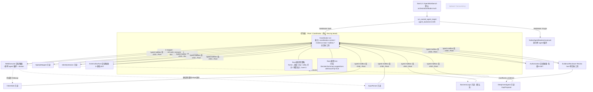

# Nest 多智能体架构现状分析（只读）

- 日期：2026-10-10（Asia/Shanghai）
- 仓库：`/Users/swyiic/Desktop/Rust/Oviraptor`，分支 `nest/master-checkpoint-2026-10-05`，HEAD `14a7875`（Checkpoint: Nest multi-agent control plane through finite-root-cost pause）
- 工作区状态：**有大量未提交改动**：`git status --short` 中 323 个 `M`、477 个 `??`。其中 544 条路径涉及 agent/multi_agent/nest，包括 `agent_runtime/multi_agent/**`、`agent_runtime/model/**`、`contract.rs` 等。另一个会话可能仍在修改这些文件，本文按 2026-10-10 12:35 的工作区快照只读分析。行号以该快照为准，之后可能漂移。
- 方法：把源码和文档只读打包拉到分析机，用 grep 加人工阅读完成。没有编译，也没有运行测试。
- 没有找到 `QWEN_STAGE1A_AUDIT_FIX_TASK.md`：在仓库内全局 `find`（排除 node_modules/target）没有结果。

---

## 0. 一句话结论

**当前 Nest 是“主从（星型）+ 确定性流水线”，不是平权 agent。** Root/Coordinator 是唯一控制面。**任务切分和派发顺序由 Rust 代码写死**，模型只能在 Rust 预先给定的固定 step 里“选中或放弃”，选中后还要经过 Rust 打分和准入。子 agent 不认领、不抢占任务，彼此不能通信，也不能互相委派，只能和 Root 通过绑定 assignment 的 mailbox 往返。

---

## 1. 协作拓扑

### 1.1 结论与依据

| 问题 | 结论 | 依据 |
|---|---|---|
| 拓扑 | **主从／星型**。每个 target attempt 只有一个 Coordinator，所有 child 都由它签发 | `lease.rs:73 acquire_coordinator_lease`、`lease.rs:139 validate_coordinator_lease`。`scheduler/assignment.rs:2 schedule_child` 每次签发都先校验 Coordinator lease 和 fencing（`:52`、`:97-98`） |
| 谁切分任务 | **确定性 Rust 代码和规则**，不是模型动态切分 | 主流程顺序写死在 `commands/agent_backend.rs:635-806 run_owned_agent_target`：`multi_agent_prepare_owned`（`:755`）→ `NativeAgentBackend.execute`（`:787`）→ `multi_agent_finish_execution`（`:788`）→ `multi_agent_authorization`（`:800`）→ `multi_agent_review`（`:804`）。`multi_agent/prepare.rs` 内部顺序固定为 bootstrap（`:142`）→ Mapper（`:159`）→ IdentitySession（`:229`，非匿名才派）→ ExternalSurface（`:281`）→ Root mapper 决策（`:283`）→ WebExecutor（`:336`）。followup 顺序固定为 ClientSide → InputParser → BusinessLogic（`multi_agent/execution.rs:141-146`、`:185-190`）。每个子任务的 task_slice 和 objective 都是代码里的字面量（如 `prepare.rs:159-162`） |
| 模型在其中的作用 | 只做**有界建议**。Root 模型的 `suggestions` 必须包含 frame 预先映射好的那个固定 step；Rust 再重算 utility，≤0 拒绝 | frame kind→固定 step 的单表在 `coordinator_frame.rs:317-342 native_coordinator_frame_step_for_kind`。Rust 准入在 `coordinator_rust_policy.rs:510-593`：`:528` trigger 与角色冲突即拒，`:539` 未选中 step 即拒，`:570` 打分，输出标 `"advisoryOnly":true`。注释“Model strings never set utility features, risk, cost, scope or capabilities”（`:82`）。`coordinator_tick.rs:1` 注释“actual dispatch remains with Rust policy”。Root 本地工具只有 `snapshot.read`/`evidence.read`（`budget/root/model/tick/local.rs:294-319`） |
| 谁分配 | **主控指派**。child run 由 Coordinator 在同一事务里创建 assignment、child run、lane lease、预算预留和能力租约；不存在 agent 认领或抢占 | `scheduler/assignment.rs:38-110`（assignment_id 由 role:trigger:target:revision 确定性派生，`:72-84`）、`:176 INSERT INTO agent_lane_leases`；lane 被占用直接拒 `agent_lane_occupied`（`:132`、`:196`）。worker 身份由调度签发，“No read path issues a replacement identity”（`attempts.rs:1-3`） |
| agent 间通信和委派 | **不能**。mailbox 路由只允许 Root→child 或 child→Root，并且必须绑定同一 assignment、fencing 和 revision；child↔child 一律拒绝 | `mailbox/authority.rs:35-70 route()`，不满足即 `mailbox_route_not_assignment_bound`（`:63`）。文档同样规定“其他 Agent 只能提交 Support/Challenge/SupplyPrerequisite/Duplicate，不能直接命令另一个 Agent”（MASTER_PLAN `:4031`），DeepInvestigator 的“明确禁止：命令其他 Agent”（`:3837`） |
| 并发 | 设计上三条 lane 各容量 1。实际主流程是**串行执行**，真正并行（REM-A06）未完成 | lane=1 见 `scheduler/assignment.rs:114-196`。串行调用见 `agent_backend.rs:755-806`。REM-A06 “真正并行”仍为未完成目标（`NEST_PAID_MULTI_ARCHIVE_AUDIT_2026-10-04.md:54`，REM 计划 `:19` 称 “Goal REM-A01–A14 全范围 active”） |

---

## 2. 角色清单、权限边界与接线状态

角色枚举共 15 个（`agent_runtime/contract.rs:92-130`）。权限白名单在 `scheduler/child_contract.rs:14-60`，lane 约束在同文件 `:14-36`。

| 角色 | lane / 能力（代码白名单） | 读写边界 | 生产状态 | 依据 |
|---|---|---|---|---|
| Coordinator (Root) | 控制面；`coordination.control, evidence.read, mailbox.read, mailbox.write` | 无目标工具；唯一可写终态 | **生产** | `prepare.rs:116`；`contract.rs:190 may_reduce_terminal` 仅 Coordinator；child 不能是 Coordinator（`child_contract.rs:14`） |
| SpaApiMapper | ReadOnlyAnalysis；`evidence.read, mailbox.read/write` | 只读冻结前端证据 | **生产**（默认单轮）；两轮 ReAct（v15）仅测试出生 | `prepare.rs:159`；`bootstrap.rs:137-142` v15；`root.rs:211-218` `#[cfg(test)]` |
| IdentitySession | ReadOnly；同上 | 只读，不访问目标 | **生产**（仅非匿名身份时派发） | `prepare.rs:225-270` |
| ExternalSurface | TargetTouching；`public_surface_get, evidence.read, mailbox.write` | 只做 1 次匿名 GET，不跟随重定向 | **生产**（固定匿名入口合同，`context.external_surface=true`）；输出交 Root 付费评估需 v12 出生，默认**关闭** | `multi_agent_external_surface.rs:411-480`；`agent_backend.rs:551`；`external_surface_response_receipt::enabled_on`（`:418`、`:469`） |
| WebExecutor | TargetTouching；工具集按调用逐次由 Broker 校验 | 可触碰目标（经 Broker、scope、预算） | **生产**；本体就是原单 agent 循环 | `prepare.rs:336`；`agent_backend.rs:787 NativeAgentBackend.execute`；`child_contract.rs:49-52` |
| Authorization | TargetTouching；仅 `authorization_probe` | 每个控制组 owner/cross/tester 三侧 GET | **生产，但只在操作员预置控制组时派发**；输出 Root 评估需 v11，默认**关闭** | `multi_agent/execution.rs:198-389`；`child_contract.rs:54`、`:104-106`；A03 设计文档开头状态写“只读设计，未实现、未验收”，进度表另记 v11 显式验收 |
| ClientSide | ReadOnly；`evidence.read, mailbox.write` | 只分析冻结配置观察，不调用工具 | **生产**（有冻结 HTTP 任务才派发） | `multi_agent/client_side_execution.rs:1-25` |
| InputParser | ReadOnly；`evidence.read, mailbox.write` | 只读既有请求事实；**不是**计划里的 TargetTouching 受控变体 | **生产**：flag 已翻开，但仍只读 | `coordinator_rust_policy.rs:277-285` 中 `InputParser => true`；`input_parser_execution.rs:67-112`（确定性谓词 → Root 付费选中 `dispatch:input_parser` → mint → 只读 SDK）；计划定义见 MASTER_PLAN `:3831` |
| BusinessLogic | ReadOnly；`evidence.read, mailbox.write` | 只读候选分析 | **默认关闭**：仅 v14/v15 出生才走，默认 v9 | `business_logic_execution.rs:21-38`（`schemaVersion` 必须为 14 或 15）；`coordinator_rust_policy.rs:280` 为 false |
| EvidenceReviewer | Review lane（独占）；`evidence.read, review.write` | 零目标工具，只读冻结 CandidateBundle；唯一能给 confirmed/rejected/insufficient | **生产** | `child_contract.rs:19-21`、`:38`；`multi_agent/review.rs:234-279`、`:373` |
| DeepInvestigator | ReadOnly；`evidence.read, mailbox.read/write` | 只提 GapProposal，不派任务 | **生产**（Reviewer 返回 insufficient 时） | `multi_agent/gap_investigation.rs:1-175`；`review.rs:377`、`review_validation.rs:210` |
| RepoMapper / SourceAnalyst | 源码 phase 合同另行冻结 | 只读源码切片 | **生产（源码任务）**：固定 4 phase 合同 | `native_source_coordinator.rs:12-21`；`multi_agent/source_phases.rs:22-27` |
| Upload | — | — | **未实现**（骨架，返回固定错误码） | `coordinator_stub_role_gate.rs:1-53`；`child_contract.rs:58` |
| Concurrency | — | — | **未实现** | 同上 `:59` |

### 2.1 当前 flag 和开关状态（快照）

| 开关 | 当前值 | 依据 |
|---|---|---|
| 新 Web 任务编排模式 `WebMode` | 缺省 **Multi**（`None` 或 `"multi"`），可选 Single | `agent_runtime/web_mode.rs:25-31`；UI 缺省 `AgentWorkbench.vue:68` |
| 旧持久化 `MultiAgentPolicy` | 缺省 Single；激活 Coordinator 时写入 `'multi'` | `contract.rs:273-301`；`prepare.rs:114` |
| Root 出生合同（BootstrapDispatch） | 生产默认 **v9**（web-expiry）；v10–v15 只有 `#[cfg(test)]` 出生入口 | `web_mode/root/bootstrap.rs:53-55`、`:94-99`；`web_mode/root.rs:138`（生产）、`:153-250`（全部 test） |
| `native_root_role_prepare_implemented` | InputParser=true；BusinessLogic/Authorization/ExternalSurface=false | `coordinator_rust_policy.rs:277-285` |
| Root `schedule_decision` 可派发角色 | 只有 WebExecutor、DeepInvestigator；其余要么走专用入口，要么返回 not_ready 或未实现 | `coordinator_schedule_decision_role_gate.rs:1-25` |
| 监督触发 frame | 18 类已接线；`human-recovery` 仍 not_ready；A03 producer blockers 共 5 项未清 | `coordinator_rust_policy.rs:5-35`、`:147-153` |
| 角色配置（Role Studio） | 只是草稿，状态标签固定为“配置草稿，尚不能执行”；有 IPC，但前端没有页面调用 | `role_config.rs:1-13`；`lib.rs:451-453`；`src/features/sentinel/api.ts:350-359` 只定义 API，无组件引用 |
| 生产沙箱 | unsupported（Darwin 32MiB setrlimit EINVAL） | REM 计划 `:19` |

---

## 3. 预算、授权、审计：谁控制

| 维度 | 控制者 | 依据 |
|---|---|---|
| 预算 | **Root 加 Rust 账本**。Root 激活时初始化 `agent_budget_ledger`；每次派发在调度事务里预留，child 只能在被授予的窗口内消费；剩余额度由 Root 计算并扣除 Reviewer 和监督留底 | `prepare.rs:122-128`、`:290-331`（`remaining_child_capacity`，Reviewer 8000/1、提案份额）；`budget/root/shared.rs:140`；`child_contract.rs` 校验 reserved_tokens/requests；Root 不能无限加预算（MASTER_PLAN `:3877`） |
| 授权（目标、工具） | **Root 签发能力租约，Broker 逐次复核**；agent 不能自我扩权，@提及也不能扩权 | `child_contract.rs:37-68`（`role_capability_not_allowed`）；WebExecutor 的工具由 Broker 按 lease+fencing 逐次检查（`:49-52`）；Coordinator 自身无目标工具（`prepare.rs:116`）；人类指令走草案→确认→Root 准入（`AgentDialog.vue:335-392`，MASTER_PLAN `:4187-4226`） |
| 漏洞确认 | **只有 EvidenceReviewer** | `review.rs:279`、`:373`；MASTER_PLAN `:3378-3379` |
| 终态 | **只有 Coordinator** | `contract.rs:189-192` |
| 审计 | **运行时（Rust）统一写**：append-only 账本、HMAC 签名回执、typed mailbox ACK、`nest://collaboration-event`。agent 不自写审计 | mailbox 发送和 ACK 在 `mailbox/send.rs`；各类 `*_receipt.sql` 不可变表（如 `agent_native/business_logic_output_receipt.sql`）；前端监听 `useAgentDialogStatus.ts:226` |

---

## 4. 目标架构与现状对比

### 4.1 文档目标（摘要）
- “真正多智能体”的 15 条定义（MASTER_PLAN `:3365-3383`）：唯一 Coordinator；不同 run；**由确定性证据谓词按需触发**；Coordinator 无目标工具；Reviewer 零目标工具；lane 容量 1；只经 Assignment、证据图和 typed mailbox 协作。
- Coordinator 固定 15 步 tick（`:4033-4077`），utility 由 Rust 重算（`:4077`）。
- 需求书架构决定为“固定内核 + 可配置专家模板 + 动态实例”（`NEST_AGENT_COLLABORATION_UI_REQUIREMENTS.md:12-38`）。

**结论：文档目标本身就是主从加确定性触发，不是平权。** 现状和目标在**拓扑方向上一致**，差距在于完成度。

### 4.2 差距（按用户分层目标）

| 层 | 目标 | 现状 | 差距 |
|---|---|---|---|
| L1 稳定的原生单 agent | Native 单循环稳定，可恢复 | 已有（`NativeAgentBackend.execute`，Single 模式直接走 `agent_backend.rs:715-719`）；Multi 下的 WebExecutor 也复用它 | 恢复与全通道清理（REM-A07）、Single 恢复生产断点仍在进行（progress `:390`）；全库门禁未重验（REM `:19`） |
| L2 多 agent 协作 | 按需触发、多角色并行、独立 Reviewer | 已有：星型控制面、lane、fencing、预算账本、mailbox、Reviewer、Investigator；生产实际跑 Mapper→(Identity)→Surface→Executor→ClientSide/InputParser→(Auth)→Reviewer→(Deep) | ① 编排是写死的串行流水线，不是 tick 驱动的事件调度（Root 只在固定点被调用）；② 无真实并行（REM-A06）；③ BusinessLogic/Authorization 输出/ExternalSurface 输出只在 v11–v15 测试出生下可用，默认 v9 关闭；④ Upload/Concurrency 未实现；⑤ InputParser 仍只读，与计划中的“受控变体”不符；⑥ General ReAct 和统一 Broker（REM-A04）未完成；⑦ human-recovery 监督 not_ready |
| L3 可操作的 Nest UI | 协同台、团队栏、审批、人工接管 | 已有：AgentDialog 团队频道和线程、HumanDirective 草案→确认（批准/修改/拒绝）、有序只读评估、Root 决策摘要、预算诊断、实时事件 | Role Studio 只有后端草稿 API，没有页面；自定义 Agent 不能执行；整体 UI 验收（REM-A10）和安装 App 的实际 IPC 验收未完成；需求书顶部的状态行（“没有协同台、HumanDirective”）已过期 |

### 4.3 对照“第一版目标”

| 第一版要素 | 状态 |
|---|---|
| 原生单 agent | ✅ 基本具备（恢复和全门禁仍在收口） |
| 角色配置 | ⚠️ 只有不可执行的草稿和 IPC；没有 UI；`AgentDefinition` 未落地 |
| 只读分析协作 | ✅ Mapper / Identity / ClientSide / InputParser / Reviewer / DeepInvestigator 已接生产，均为只读；BusinessLogic 默认关闭 |
| 过程展示 | ✅ 团队频道、线程、Root 决策、逐路日志和预算面板；“真实 App 验收”未完成 |
| 人工补充 | ✅ HumanDirective 草案→确认→Root 准入，可做队列优先级或有序只读评估；`human-recovery` not_ready；复杂自然语言和多角色拆分未完成（MASTER_PLAN `:4241`） |

**判断**：第一版所需的主体能力已经具备，主要缺口是“角色配置可执行化和 UI”，以及“稳定性和门禁收口”。当前开发主线（REM-A01–A14、大量财务、签名、过期证明）远超第一版需要的范围，**范围膨胀是交付第一版的主要风险**。

---

## 5. 对用户说法的判定

用户原话：“平权 agent，由主管根据任务切分，然后自行分配”。

| 子命题 | 判定 | 说明 |
|---|---|---|
| “平权 agent” | **不成立** | Root 和 child 权限不对等：Root 独占 fencing、预算、派发和终态；Reviewer 独占确认；各 child 能力白名单不同；child 之间不能通信，也不能委派（§1.1、§2）。至多可以说 child 之间“彼此平级、都只对 Root 负责”，这是星型结构里的同级，不是平权协作 |
| “主管切分” | **部分成立** | 确实是主管侧切分，但切分者是 **Rust 确定性代码**（写死的流水线、frame→step 单表、谓词触发），不是 Root 模型自由拆解。Root 模型只能在单一固定 step 上表态，Rust 还要打分和准入 |
| “自行分配” | **不成立** | 没有认领或抢占机制；assignment 由 Coordinator 在调度事务内签发并绑定 worker；lane 被占即拒，不排队抢 |
| “平权”与“主管切分”的矛盾 | 二者互斥 | 平权（peer）意味着没有中心，任务靠协商或自领；主管切分意味着中心化控制。代码和文档都明确选择中心化：MASTER_PLAN 的“唯一 Coordinator”，需求书的“Coordinator：唯一全局队列、预算、授权范围和目标终态控制者”（`:16`） |

**准确表述应为**：*Nest 是“单一 Coordinator + 确定性 Rust 调度 + 模型有界建议 + 专职 child（只读/目标触碰/复核分 lane）”的主从星型架构；任务切分和分派由代码规则决定，模型只做选择与建议。*

---

## 6. 未找到证据或不确定的项
- `QWEN_STAGE1A_AUDIT_FIX_TASK.md`：仓库内不存在。
- 前端里没有调用 `listRoleConfigDrafts` / `saveRoleConfigDraft` 的组件（只在 `api.ts` 定义）。没有找到 Role Studio 页面的证据。
- 未运行任何测试。文中“生产”指非 `#[cfg(test)]` 的调用链存在，**不代表**真实 App 验收通过。

---

## 追问：用户期望的"主管动态分配 + 同角色多实例 + 主管审核聊天引导"模型当前有吗（2026-10-10 补充，只读核实）

核实基线：HEAD `14a7875`，工作区有约 801 项未提交改动（另一会话在改），按当前工作区只读。

用户期望模型：不分配固定角色 → 主管分析任务后分配 → 拉起 3 个同角色 agent 分别干 A/B/C → 干完向主管汇报 → 主管判断继续/停止 → 用户聊天引导须经主管审核，合理就转发，不合理就反馈用户。

### 1) 同角色多实例并行：没有

- 同一 scan/attempt/target 的每条 lane 只能有一个 assignment：`src-tauri/src/db_schema.rs:1295-1303` `agent_lane_leases` 主键是 `(scan_id,attempt_number,target_key,lane)`。抢占失败时报 `agent_lane_occupied`，见 `src-tauri/src/agent_runtime/multi_agent/scheduler/assignment.rs:114-132`（旧数据占用检查）和 `:175-197`（`ON CONFLICT DO NOTHING` 后比对持有者）。
- 去重键是 `role:trigger:target:evidence_revision`，**不含 task_slice**（`scheduler/assignment.rs:72-81`）。所以同 role、同触发、同证据版本的 A/B/C 三个切片会算出同一个 assignment_id，只能幂等落成一个，无法变成三个实例。
- WebExecutor 要求每次是新的独立 attempt（`scheduler/assignment.rs:107-112`，`ensure_fresh_web_executor_attempt`），不能多开。
- 文档里的做法也是"一个 child 处理全部 N 组"，不是拆成多个同角色 child：`docs/NEST_A03_AUTHORIZATION_OUTPUT_IMPLEMENTATION_2026-10-09.md:64,70`（"N组聚合为同一 closed child 输出，不误把每个group算成独立child义务"）。
- 文档自己也把"全15角色真实执行与并行"列为未完成：`docs/NEST_ROOT_HUMAN_CHAT_PROJECTION_AUDIT_2026-10-05.md:79`。
- "不分配固定角色"也没有：角色是固定枚举 `AgentRole`（`agent_runtime/contract.rs:92-130`），没有可以接任意子任务的通用 worker 角色。主管汇报后续步骤由 `native_coordinator_frame_step_for_kind` 按 frame 类型固定映射（`commands/agent_native/coordinator_frame.rs:317-342`），Root 模型只能在有界的 step 里给建议（见上文主体分析）。

### 2) 用户聊天引导必须经 Root/Coordinator 审核再转发：部分有

实际链路分 4 段：

1. **草案解析由 Rust 关键词规则完成，不是主管/模型。** `agent_runtime/multi_agent/directive/interpretation.rs:98-175` 的 `interpret()` 用 `contains_any` 识别越界 URL、预算变更、暂停、清理、身份变更等。代码注释写明这只是"早期聊天守卫"，不是授权边界（`:57-60`）。不合规直接标 rejected 或 need_confirmation。
2. **用户自己确认草案。** `directive/confirmation.rs:10-42,126-133,172-209`：只有 drafted/need_confirmation 状态能确认，rejected 不能确认。确认后写入 `agent_user_directives`，状态为 `pending`。
3. **Root 付费评估。** `commands/agent_native/coordinator_human_hook.rs:1`（"Root consumes original human facts before any queue/role/model delivery action"）。每条 accepted 指令都要做一次 human-directive frame 的付费 Root tick（`:27-66`），frame 步骤固定为 `assess:human_directive`（`coordinator_frame.rs:255,323`）。suggestions 为空就是 `root_human_directive_deferred`（`coordinator_human_hook.rs:81-92`）。有任何一条 accepted 指令没评估过，报 `root_human_unassessed_confirmation`（`:107-113`）。
4. **评估通过后才拼进 WebExecutor 模型上下文。** `commands/agent_native/web_executor_adapter.rs:109-157`：先 `apply_assessed_human_queue_actions`，再 `round_history.extend(directives.messages())`。

与期望的差别：

- Root 只能对固定步骤说"做/延期"，不能改写指令或决定转给哪个 agent。转发对象实际只有 WebExecutor 的模型上下文和队列动作。
- Root 判"不合理"时，后端直接把本轮结果设为 `AgentTargetOutcome::incomplete("root_human_directive_deferred")`（`web_executor_adapter.rs:126-129`），本轮结束。没找到"给用户回一条解释、任务继续跑"的闭环。UI 只显示延期原因的可读文案，而且明确"建议保持 advisoryOnly"（`docs/NEST_ROOT_HUMAN_CHAT_PROJECTION_AUDIT_2026-10-05.md:15`），"未知/失败与显式恢复闭环"还在待办（同文件 `:79`）。
- 预算不够时，指令延期挂在原 parent 下（`coordinator_human_hook.rs:117-137`，`web_executor_adapter.rs:115-124`），也不会反馈用户。

### 3) 与现有"指令草案 → 确认 → Root 准入"的差异

| 维度 | 用户期望 | 当前实现 |
|---|---|---|
| 第一道审核 | 主管（智能判断） | Rust 关键词规则 `interpret()`（interpretation.rs:98） |
| 人工环节 | 只有用户发起，不需要再确认 | 用户必须再确认一次草案（confirmation.rs:42-209） |
| 主管职责 | 理解后决定转发给谁、怎么改写 | Root 付费评估只能对固定 `assess:human_directive` 步骤做/延期（coordinator_frame.rs:323；human_hook.rs:81-92） |
| 转发目标 | 任意相关 agent | 只有 WebExecutor 模型上下文/队列（web_executor_adapter.rs:113-157） |
| 不合理时 | 反馈用户，任务继续 | 本轮 incomplete 结束，或按容量延期（web_executor_adapter.rs:113-130）。"给用户解释并继续"未找到证据 |
| 能改什么 | 自由引导 | 不能扩 scope、改预算、换身份、清理（interpretation.rs:120-175；controlled_action_guard.rs） |

### 总判

当前**没有**这个模型。Nest 是固定角色、每 target 每 lane 单实例、按确定性管线串行派发的主从结构，不支持"主管动态拆 A/B/C、拉起 3 个同角色 agent 并行"。聊天引导确实要经 Root 付费评估才能进 WebExecutor，但前面还有 Rust 规则解析和用户确认两道关；Root 只能"做/延期"，延期会直接让本轮 incomplete，没有"不合理就解释给用户、任务继续"的闭环。所以只能算"Root 门控引导"的雏形。
