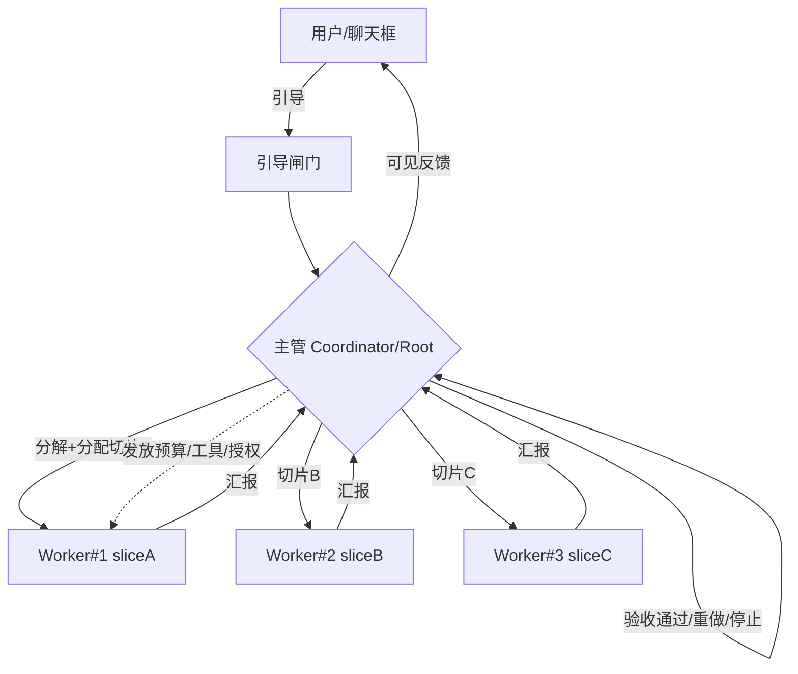
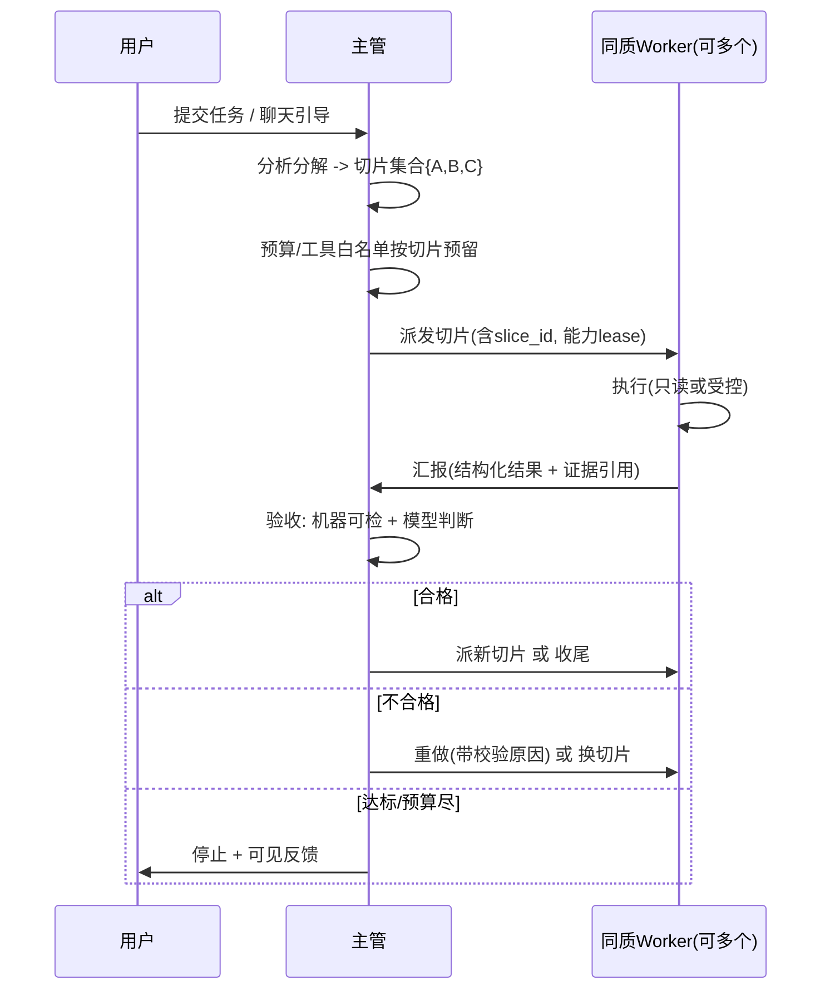
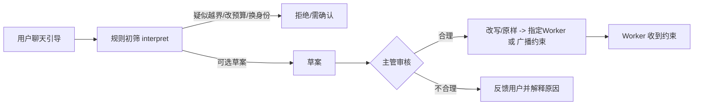

# Nest 同质 Worker + 强主管调度架构（目标态设计）

> 版本：2026-10-10 ｜ 语言：中文 ｜ 性质：**目标态设计文档**，不是现状。
> 现状以 `docs/NEST_ARCHITECTURE_ANALYSIS_2026-10-10.md`（只读分析）为准；本文凡标「现状」均给文件路径，不确定处写「待核实」。
> 本文只新增，不改代码、不改旧文档、不 commit。

---

> **Codex 交接（深度分析）**：[`NEST_HOMOGENEOUS_CODEX_HANDOFF_DEEP_ANALYSIS_2026-10-11.md`](NEST_HOMOGENEOUS_CODEX_HANDOFF_DEEP_ANALYSIS_2026-10-11.md)；实现话术：[`NEST_CODEX_IMPLEMENTATION_TASK_PROMPT_2026-10-11.md`](NEST_CODEX_IMPLEMENTATION_TASK_PROMPT_2026-10-11.md)。含产品入口缺口与意图产出闸门（§J）。

> **设计定稿（实现依据）**：[`NEST_HOMOGENEOUS_COORDINATOR_DESIGN_2026-10-10.md`](NEST_HOMOGENEOUS_COORDINATOR_DESIGN_2026-10-10.md)；冲突裁定 DESIGN > SPEC > ARCHITECTURE。
> **Qwen 实现话术**：[`NEST_QWEN_IMPLEMENTATION_TASK_PROMPT_2026-10-10.md`](NEST_QWEN_IMPLEMENTATION_TASK_PROMPT_2026-10-10.md)（勿再用已废弃的 DESIGN_TASK 话术）。

> **详细规格（给 Qwen 照抄）**：[`docs/NEST_HOMOGENEOUS_COORDINATOR_SPEC_FOR_QWEN_2026-10-10.md`](NEST_HOMOGENEOUS_COORDINATOR_SPEC_FOR_QWEN_2026-10-10.md)
> 含完整类型/JSON Schema、七动作契约、状态机、降级伪代码、system 提示、25 条黄金集与代码对接点。
> 冲突时以详细规格的封闭枚举与 schema 为准。

## 0. 文档审核结论（先读这一节）

对现有 `docs/` 下 Nest / 多 agent / 主管调度相关文档做了只读审核（共约 280 个相关 md）。按与「同质 Worker + 强主管」目标态的关系分三类：

### 0.1 描述「已完成/已接线能力」——与目标态不冲突，继续参考
- `docs/NEST_ARCHITECTURE_ANALYSIS_2026-10-10.md`：现状基线（固定角色星型 + 确定性管线）。**本文的现状引用全部以它为准。**
- `docs/OVIRAPTOR_AGENT_RUNTIME_ARCHITECTURE.md`：运行时底座（模型网关 §5、Tool Broker §6、沙箱 §7、预算租约 §10、终态 reducer §15、Policy Engine §13）。这些底座目标态要复用，**不推翻**。
- `docs/NEST_ROOT_HUMAN_CHAT_PROJECTION_AUDIT_2026-10-05.md`：人工指令→Root 付费评估→聊天投影链路，已接线但自承「建议保持 advisoryOnly」「未知/失败显式恢复闭环未完成」（该文 15、79 行）。目标态的「引导闸门」在它之上扩展。

### 0.2 描述「过期计划/阶段快照」——建议标注「仅作历史」
- `docs/NEST_IMPLEMENTATION_PROGRESS_2026-09-23.md`、`docs/NEST_REM_CONTINUATION_PLAN_2026-10-06.md`、`docs/NEST_CONTINUATION_HANDOFF_2026-10-01.md`、`docs/NEST_STRIX_FREE_MULTI_AGENT_MASTER_PLAN.md`：体量巨大、混杂大量 REM-A/财务结算/过期收尾流水账，阶段性强、时效短。目标态只需提取其「角色触发谓词」「mailbox envelope」「证据图」概念，**其余建议归档为历史**，不要当成当前待办清单。
- 大量 `NEST_*_AUDIT_*.md`（source/single/multi/财务/删除保留/在途结算等上百篇）：都是某次改动的验收快照，**对目标态无直接约束，建议整体归档为历史**，需要时按文件名检索即可。

### 0.3 与目标态「冲突」——需要明确取舍
- `docs/NATIVE_MULTI_AGENT_REFACTOR_REQUIREMENTS.md`（§2「明确不做什么」）与 `docs/OVIRAPTOR_AGENT_RUNTIME_ARCHITECTURE.md`（§9 Spawn 条件）**显式禁止**「多个相同单 Agent 循环并行扫描同一 URL」「多个 Agent 同时对同一目标发请求换速度」。这跟用户要的「拉起 3 个同质 Worker 分别干 A/B/C」**正面冲突**。
  - 取舍：旧文档的禁令针对的是**同目标重复请求/重复劳动**；目标态允许同质 Worker 并行，但前提是**切片互不重叠、互不写同一状态**（见 §3.1）。即「允许同质并行、禁止重复劳动」，不是推翻旧不变量，而是收窄它的适用边界。
- 旧文档的角色是「固定专家角色 + 确定性触发谓词」；目标态是「弱化固定角色 + 主管动态分配同质 Worker」。二者是**两种拓扑**，迁移策略见 §3.7（过渡期双模）。

> 结论一句话：底座（模型网关/Broker/沙箱/预算/reducer）继续用；现状分析文档继续用；Master Plan 与海量 AUDIT 归档为历史；Refactor 任务书的「禁止同质并行」条款需按 §3.1 收窄。**不删除任何旧文件**，仅在本文标注归档建议。

---

## 1. 目标与非目标

### 1.1 目标
1. **弱化固定角色**：不再为每种任务预置一个专家角色；主体是「同质 Worker」（统一能力画像），差异只在任务切片。
2. **主管先分析再分配**：接到任务后，主管（Coordinator/Root）先做任务分解，再决定切片与分配。
3. **同质多实例并行**：可拉起多个角色相同的 Worker，分别干 A/B/C 切片。
4. **汇报—验收—再调度闭环**：Worker 干完向主管通报，主管判断是否合理、正确、达标，再派新活或重做或停止。
5. **聊天引导闸门**：用户可经聊天框引导；引导必须经主管审核，合理转发给 Worker，不合理反馈用户并解释。
6. **弱模型可控**：在接入较差的国内模型 API 时，主管仍能正常干活、不显著偏离预期（详见 §4）。

### 1.2 非目标（明确不做）
- 平权 agent 之间互相委派任务。
- 子 Worker 之间直接通信/自然语言协商（仍走主管中转，参考现状 `mailbox/authority.rs` 的 Root-child 路由）。
- 用户绕过主管直达 Worker。
- 应用安全漏洞扫描的具体检测逻辑（本文只谈协作拓扑与调度，不谈漏洞规则）。
- 不追求「几十个常驻 agent」，并发数由主管按预算与切片数动态决定。

### 1.3 与现状差异表（现状依据：`docs/NEST_ARCHITECTURE_ANALYSIS_2026-10-10.md`）

| 维度 | 现状 | 目标态 |
|---|---|---|
| 拓扑 | 固定角色星型 + 确定性管线（分析文档 §拓扑） | 唯一主管 + N 个同质 Worker |
| 角色 | 固定枚举 `AgentRole`（`agent_runtime/contract.rs:92-130`） | 弱化角色，统一 Worker 能力画像 + 切片 |
| 任务切分 | 写死的管线顺序（`run_owned_agent_target`） | 主管分析后动态分解 |
| 同质并行 | 同 target 每 lane 单实例（`db_schema.rs:1295-1303`，`agent_lane_occupied`） | 同 target 允许多 Worker 并行（需改 lane 主键，§2.4） |
| 去重键 | `role:trigger:target:evidence_revision`，**不含切片**（`scheduler/assignment.rs:72-81`） | 必须含 `task_slice_id` |
| 验收 | Reviewer 门禁 + Root 固定步骤建议 | 显式 acceptance verdict 环（§2.2） |
| 聊天引导 | 规则初筛→用户确认→Root「做/延期」（`web_executor_adapter.rs:113-129`） | 规则初筛→主管可改写/拒绝并解释→定向转发 |
| 主管「脑」 | advisoryOnly 建议 + Rust 重算（`coordinator_rust_policy.rs:510+`） | 结构化 JSON 决策 + 硬护栏 + 弱模型评测门禁 |

---

## 2. 详细架构（目标态）

### 2.1 拓扑
- **唯一主管（Coordinator/Root）**：任务分解、切片分配、验收裁决、预算/授权发放、引导审核。有租约与 fencing token，保证同时只有一个有效主管（复用现状 `multi_agent/lease.rs`）。
- **N 个同质 Worker**：同一能力画像（同工具白名单上限、同输出契约），区别只在 `task_slice`。Worker 不互相通信、不自行扩权、不自行领新活。

### 2.2 一次任务闭环生命周期

状态机（建议）：`created → decomposed → assigned → running → reported → accepted|rejected_retry|stopped`。

### 2.3 数据模型建议
- `task_slice`：`{ slice_id, parent_task_id, scope（域名/路径/来源类型等确定性边界）, evidence_revision_base, worker_capability_profile_id }`。slice_id 全局唯一、不可漂移（terminal 后不得增减，参考 A03 文档对「一个 closed child 输出集合冻结」的要求）。
- `assignment`：`{ assignment_id, slice_id, worker_run_id, lane, state, reserved_tokens, reserved_requests, capability_lease[] }`。**去重键必须含 slice_id**（修掉现状 `role:trigger:target:evidence_revision` 缺切片的问题）。
- `acceptance_verdict`：`{ assignment_id, verdict: accept|retry|reject, machine_checks{...}, model_judgement{...}, reason_codes[], evidence_refs[], decided_by_lease_epoch }`。不可变、可回放。
- `human_directive_gated`：`{ directive_id, raw_redacted, rule_screen_result, coordinator_action: relay|rewrite|reject, rewritten_text?, target_worker?/broadcast_constraint?, user_feedback, receipt_id }`。

### 2.4 通道与并发（对现有 lane 主键的改造方向）
- **现状**：`agent_lane_leases` 主键 `(scan_id, attempt_number, target_key, lane)`，同 target 每 lane 仅一个占用（`db_schema.rs:1295-1303`），第二个报 `agent_lane_occupied`（`scheduler/assignment.rs:114-132, 175-197`）。这是同质并行的主要阻塞点。
- **改造方向**：把 lane 从「互斥槽」改为「可配额槽」。
  - 主键加入 `slice_id`：`(scan_id, attempt_number, target_key, lane, slice_id)`；或引入 `lane_slot` 容量表 `{ lane, max_parallel }` 由主管按预算设定。
  - 冲突判定从「lane 是否被占」改为「同一 slice/同一写状态是否被占」——**保留旧不变量的本意**（禁止两个 Worker 写同一状态、禁止对同一子目标重复请求），只放开「不同切片并行」。
  - `read_only_analysis` lane 天然可高并发（只读）；`target_touching` lane 仍需严格串行化到「同一写目标」粒度。

### 2.5 权限与预算
- 预算与工具授权**仍由主管按切片发放**（复用现状预算租约 `budget/*` 与 Tool Broker）。Worker 拿到的是「本切片的工具白名单 + token/请求额度 lease」，**不能自行扩权、不能改预算、不能换身份**。
- 验收门禁：未通过 acceptance_verdict 的产物不得进入最终结论（延续现状 Reviewer 发布门禁思路）。

### 2.6 聊天引导闸门

- 第一道：Rust 规则初筛（复用现状 `directive/interpretation.rs:98-175` 的 `interpret()`，拦截越界 URL、改预算、暂停、清理、换身份）。
- 第二道：主管审核。目标态**新增**能力：主管可以「改写」（在白名单内收窄引导）或「拒绝并给用户可读理由」，而不仅是现状的「做/延期」（现状 `coordinator_human_hook.rs:81-92`，延期会让本轮 incomplete，见 `web_executor_adapter.rs:126-129`）。
- 第三道：定向转发——主管指定目标 Worker 或下发广播约束；用户始终看到可见反馈。

---

## 3. 用户未提到但必须补的设计

### 3.1 切片边界与证据修订（避免重复劳动/结果打架）
- 切片 scope 必须是**确定性可判定的互斥边界**（如按域名、路径前缀、来源类型划分），由 Rust 校验不重叠；重叠切片直接拒绝分配。
- 所有 Worker 基于同一 `evidence_revision_base` 出发，产出以**追加式证据修订**提交（延续现状「evidence revision 不可变增量」概念），主管合并时按 revision 顺序消解冲突，禁止覆盖写。
- 「允许同质并行、禁止重复劳动」= 并行的是不同切片，不是同一子目标的重复请求（对齐 §0.3 的旧不变量本意）。

### 3.2 幂等与崩溃恢复
- assignment 以 `(slice_id, attempt)` 幂等落地；同切片重入必须是新 attempt，不原地续命（延续现状 `ensure_fresh_web_executor_attempt` 思路）。
- Worker 崩溃：主管通过心跳/租约到期（复用 `scheduler/heartbeat.rs`、`lease.rs`）回收该切片，置为 `rejected_retry` 并重新派一个新 attempt；已提交的证据修订保留，未完成的预留额度按原结算释放。

### 3.3 验收：机器可检 vs 模型判断
- **机器可检**（硬门禁，Rust）：切片 scope 未越界、预算未超、工具在白名单内、输出 schema 合法、证据引用存在且指向本切片 revision。任一不过直接 `reject`，不进模型。
- **模型判断**（主管脑，有界）：结果是否「合理/达标」、是否需要补切片。模型只在机器可检全过后介入，且输出受 §4 的结构化约束。

### 3.4 停止/取消/部分成功语义
- `stop`：主管主动收尾（达标或预算尽），发布已验收结果 + 可见反馈。
- `cancel`：用户取消，正在跑的 Worker 按现状暂停/撤权路径收尾，不伪造完成。
- `partial_success`：部分切片通过、部分失败——发布通过切片的证据，失败切片标 reason_codes，**不以偏概全**（对齐 A03 文档「partial/failed 不发行正常 output seal」）。

### 3.5 审计与可回放
- 用户、主管、Worker 三方动作全部留痕：引导原文（脱敏）、规则初筛结果、主管裁决理由、切片派发、Worker 汇报、acceptance_verdict，均不可变、带 lease_epoch/fencing token，可按原 revision 回放（复用现状付费回执/发布事实链）。

### 3.6 安全边界
- Worker 工具白名单**由主管按切片授予**，Worker 不能改预算、不能换身份、不能扩 scope、不能发起跨项目写入。
- 引导不能提权：现状 `interpret()` 已拦截越界 URL/改预算/换身份，目标态保持这一硬护栏。

### 3.7 与现有固定角色系统的迁移策略（过渡期双模）
- **双模并存**：`legacy_role_pipeline`（现状固定角色管线，继续可用）与 `homogeneous_workers`（新同质 Worker），由任务级开关选择，默认 legacy。
- **渐进替换顺序建议**：
  1. 先在 `read_only_analysis` lane 落地同质 Worker（只读，风险最低，天然可并行）。
  2. 再做验收环与切片去重键改造。
  3. 最后处理 `target_touching` lane 的受控并发（需写状态互斥粒度到位后才开）。
- 迁移期不删除 legacy 路径，两套共用底座（模型网关/Broker/沙箱/预算/reducer）。

### 3.8 UI
- 过程展示：切片列表 + 每个 Worker 的实时状态/进度。
- 主管裁决理由：每次 accept/retry/reject 的 reason_codes 与证据引用可见。
- 引导驳回理由：用户引导被拒时展示可读原因（补上现状「仅显示延期原因、advisoryOnly」的缺口，参考 `NEST_ROOT_HUMAN_CHAT_PROJECTION_AUDIT_2026-10-05.md:15`）。

### 3.9 测试策略
- 契约测试：切片不重叠校验、去重键含 slice_id、lane 配额、acceptance schema。
- 对抗弱模型回归集：见 §4.6。

---

## 4. 「修主管的脑子」——弱模型（含较差国内 API）仍能干活

核心思想：**模型只做有界决策，Rust 做不可绕过的护栏。** 现状已有「advisoryOnly 建议 + Rust 重算分数」的雏形（`coordinator_rust_policy.rs:510+`，模型 suggestions 必须命中固定 step，否则 `root_decision_did_not_select_step`）；本章把它系统化、强化到可对抗垃圾模型。

### 4.1 原则：模型只做有界决策，Rust 做护栏
- 主管模型的每次输出必须是**严格 JSON schema**，Rust 严格解析；不接受自由长文当指令。
- 任何最终副作用（派发、扩预算、发结论、转发引导）都要 Rust 护栏复核，模型说了不算。

### 4.2 决策空间收缩
- 动作枚举（封闭集合）：`decompose / assign / accept / reject_retry / stop / relay_directive / reject_directive`。
- 每个动作带必填字段；**缺字段或出现越权字段 → 整单作废**，走确定性降级（§4.5）。
- 候选切片、工具、目标必须从 **Rust 提供的 allowlist** 里选（返回候选 id，模型只能挑 id）；**禁止模型发明新 URL/新工具/新目标**（对齐现状 `interpret()` 的越界拦截）。

### 4.3 双轨评分（强化现有 advisoryOnly）
- 模型给建议 → Rust 用确定性权重**重算分数**（现状 `coordinator_rust_policy.rs` 已有 impact/evidence/coverage 等权重）。分数 ≤0 或与证据矛盾 → 拒绝并记 reason_codes。
- 关键不变量**全部硬拒绝、不可被模型覆盖**：预算不超支、lane/切片不冲突、工具未授权、跨项目写入、身份变更。

### 4.4 针对弱模型的提示与上下文工程
- **短系统提示 + 固定「决策卡」模板**，中文为主，避免长英文推理链。
- 每轮只给**结构化证据摘要**（已确认/已排除/待验证/覆盖缺口），**禁止把整页 HTML/大 JSON 灌给主管**（对齐底座 §5「上下文四层 + artifact id 按需取」）。
- **少步决策**：一次只裁决一件事（一个切片或一条引导），降低幻觉面。
- **反例库**：把历史跑偏案例做成 few-shot「错误→正确」对照注入。

### 4.5 校验、重试与降级
- schema 解析失败 → 自动重试有限次（如 2 次），每次回传**具体校验错误**让模型自纠。
- 连续失败 → **确定性降级路径**：按规则切分（域名/路径/来源类型）、只串行派一个 Worker、或暂停等用户确认。
- **绝不静默「假装成功」**：降级必须在 UI/审计显式标注（对齐旧文档「禁止伪完成」）。

### 4.6 评测与准出
- 建「主管脑」黄金集，覆盖：任务分解、验收判断、驳回不合理引导、预算边界、**弱模型胡言/越权/编造工具** 等对抗样本。
- **新接入任何国内模型 API 必须先跑这套**才能上线。建议阈值：关键用例（越权拒绝、预算硬护栏、编造工具拦截）通过率 **100%**；整体 **≥95%**。
- 线上监控指标：裁决被 Rust 驳回率、schema 重试率、用户驳回引导率、降级触发率。任一异常升高即告警。

### 4.7 模型适配层
- Provider 适配：统一 `temperature`（低温）、`max_tokens`、`json_mode`；对**不支持 json_mode** 的 provider，改用「提示约束 + 输出提取 + 严格校验」兜底。
- 输出清洗：剥离思维链泄露、去 markdown 围栏，再喂给严格 JSON 解析器。
- 复用底座模型网关（`OVIRAPTOR_AGENT_RUNTIME_ARCHITECTURE.md:185` §5）的云端/本地分流、超时与 retry 分类，不新建第二套配置。

---

## 5. 分阶段落地建议（只列通向目标态的增量，去掉已完成的 REM/财务细节）

| 阶段 | 内容 | 一句话验收标准 |
|---|---|---|
| 阶段 0 | 文档与契约：确立同质 Worker 能力画像、slice/assignment/verdict/directive_gated schema | schema 与契约测试冻结，评审通过 |
| 阶段 1 | 同质 Worker + 切片 id：去重键含 slice_id，read_only lane 配额并行 | 同一 target 能并行跑 3 个不重叠切片且无 `agent_lane_occupied` 误拒 |
| 阶段 2 | 主管验收环：acceptance_verdict（机器可检 + 模型判断） | 不合格切片走 retry、合格才进结论，全程可回放 |
| 阶段 3 | 引导闸门升级：主管可改写/拒绝并反馈用户、定向转发 | 不合理引导被拒时用户看到可读理由，任务不被误杀 |
| 阶段 4 | 弱模型评测门禁：黄金集 + 准出阈值 + 线上监控 | 新国内模型 API 跑黄金集达阈值方可启用 |

（`target_touching` lane 的受控并发排在阶段 2 之后、写状态互斥粒度到位后再开。）

---

## 6. 与旧文档关系

### 建议继续参考
- `docs/NEST_ARCHITECTURE_ANALYSIS_2026-10-10.md`（现状基线）
- `docs/OVIRAPTOR_AGENT_RUNTIME_ARCHITECTURE.md`（运行时底座，复用）
- `docs/NEST_ROOT_HUMAN_CHAT_PROJECTION_AUDIT_2026-10-05.md`（引导链路现状，在其上扩展）
- `docs/NATIVE_MULTI_AGENT_REFACTOR_REQUIREMENTS.md`（仅取角色触发谓词/mailbox/证据图概念；「禁止同质并行」条款按 §0.3/§2.4 收窄）

### 建议归档为历史（不删除，仅标注「仅作历史」）
- `docs/NEST_STRIX_FREE_MULTI_AGENT_MASTER_PLAN.md`（6000+ 行，混杂过期流水账）
- `docs/NEST_IMPLEMENTATION_PROGRESS_2026-09-23.md`、`docs/NEST_REM_CONTINUATION_PLAN_2026-10-06.md`、`docs/NEST_CONTINUATION_HANDOFF_2026-10-01.md`
- 全部 `NEST_*_AUDIT_*.md` 验收快照（上百篇，按需检索即可）
- `docs/NEST_A03_AUTHORIZATION_OUTPUT_IMPLEMENTATION_2026-10-09.md` 等 REM-A03 系列（财务/输出细节，目标态不直接依赖）

> 再次强调：以上仅为归档建议，**不删除任何文件**，HEAD 不动。
